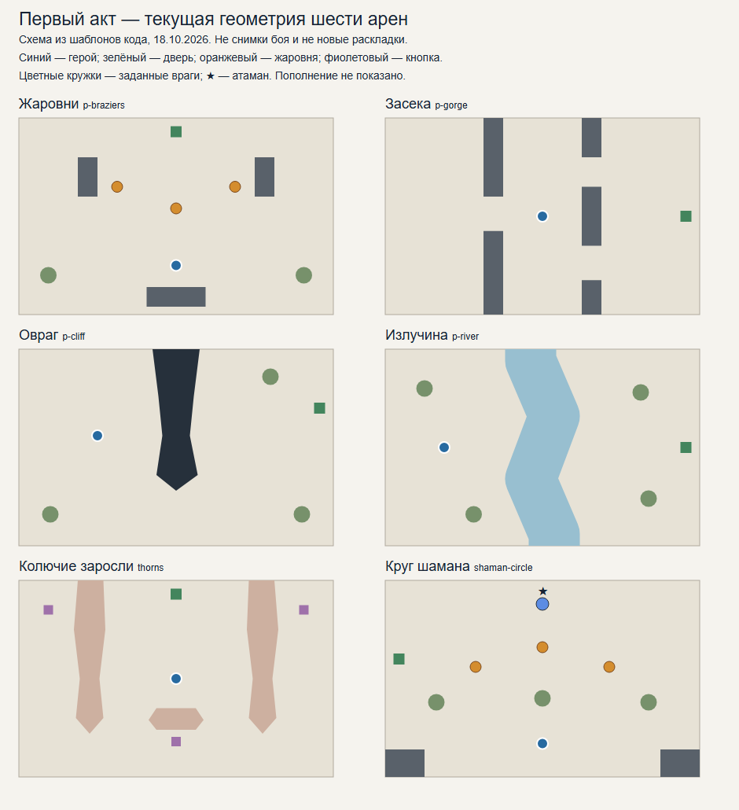

# Первый акт: как усилить различия между аренами — идея от Codex

**Автор: Codex. Дата: 18.10.2026. Статус: дизайн-аудит текущих арен и предложения; изменения игры не реализованы и не утверждены.**

Продолжение: [подробная переделка первого акта](codex-idea-act1-redesign.md) объединяет 22 карточки, конкретные составы и кривые. Оно уточняет размеры и порядок опытов из этой ранней заметки; все варианты не складываются в обязательный список одновременных изменений.

Запрос пользователя: разобрать уже существующие уровни первого акта и предложить улучшения. Под первым актом здесь понимается лесной поход до перехода в гарнизон. Пролог «Опушка» — отдельное обучение перед походом; его комнаты не перепроектируются этим документом.

Основа — чтение кода полей, выбора встреч, составов и пополнения. Это не новый плейтест. Риски ниже — гипотезы, которые объясняют возможное сходство боёв, а не измеренные недостатки каждой арены.

## 1. Главная рекомендация

**Сначала сделать выразительнее решения на существующих полях. Новые приёмы каждому врагу для этого не обязательны.** У нас уже есть вода, обрывы, узкие проходы, жаровни, кнопки, атаманы и части боссов. Они позволяют строить разные встречи, если сохраняют значение в ходе боя.

У каждой арены предлагается выделить один основной вопрос:

- Жаровни: **как провести цепь, чтобы силы хватило на нужную цель?**
- Овраг: **перелететь здесь или обойти по суше?**
- Засека: **в каком проходе принять толпу и когда сменить сторону?**
- Двор кнопок: **какую точку взять следующей и где закончить цепь?**
- Стрелковая гряда: **устранить помеху по пути или раньше добраться до атамана?**
- Круг шамана: **выключить усиление сейчас или собрать более сильный удар по источнику?**

Хорошая встреча не обязана требовать единственного правильного маршрута. Нужны два понятных ответа с разной выгодой; доступность конкретной цепи зависит от текущего поля и сборки.

## 2. Как первый акт устроен сейчас

### Выбор встреч

В обычном новом походе и на «Испытании I» интерфейс передаёт историю знакомых механик, и работает [расписание леса](../../src/realtime/run/schedule.ts). Оно выбирает следующую готовую тему по истории игрока, номеру боя и ограничениям ряда. Новая тема вводится рядом с уже знакомыми. Поэтому первый акт — **не фиксированная последовательность «арена 1, арена 2, арена 3»**.

На «Испытании II» и выше, а также в сохранениях без расписания, остаётся выбор через [пулы рядов](../../src/realtime/run/arenaPools.ts). Включение режимов — [rtRun.ts](../../src/realtime/run/rtRun.ts), передача истории — [runView.ts](../../src/realtime/view/runView.ts). Ниже рекомендации к самим встречам; изменение порядка их выдачи рассматривается отдельно.

Для расписания доступны 17 обычных полей, «Застава» и «Последний рубеж». Дополнительно используются Тюремщик в двух вариантах и Тролль: всего **22 идентификатора арен** в области этого аудита. Два варианта Тюремщика не считаем двумя разными боссами.

- Первые четыре ряда похода — подход к Тюремщику; пятый — его узел. Затем ветви, прорыв и финал леса на десятом ряду похода.
- Трудный узел с расписанием получает «Заставу» после знакомства с обрывом и элитой; до этого возможна подходящая обычная арена с усилением плотности трудного боя.
- Ветка логова заканчивается Троллем, если включён его действующий флаг; ветка Главаря пока использует «Последний рубеж». [Главарь с «Обедом!»](task-54-chief.md) — существующая отдельная спека, не реализованный в текущем дереве финал.
- Незнакомые виды могут исключаться из боя. Нельзя автоматически переносить весь собственный состав шаблона в описание каждого раннего похода.

### Старт, развитие и выход — три разные части встречи

1. **Старт.** [createWorld](../../src/realtime/sim/world.ts) ставит врагов из `template.enemies`. В 12 из 22 рассматриваемых шаблонов авторских стартовых врагов нет. Это не означает пустой бой: вскоре появляются метки и добор плотности.
2. **Развитие.** [Состав](../../src/realtime/sim/rosters.ts) меняет пополнение и доли стай/кабанов, но сам по себе не переставляет стартовые цели и геометрию. Пополнение включает добор до минимума и периодические группы. Общая база — 28 тел/запланированных появлений, интервалы 3–5 с, группы 2–4, но поход, размер поля и особые арены вносят поправки. Это не одинаковые фактические числа во всех боях.
3. **После цели.** Таблица нарастающего давления включается после выполнения задачи. До цели она не создаёт заранее поставленную кульминацию боя. Дверь, котомка и решение остаться за наградой образуют отдельный этап; они не должны маскировать слабую основную встречу.

На больших аренах точки появления выбираются вокруг героя в прямоугольнике появления. Геометрически большой уровень поэтому тоже может ощущаться как одна и та же локальная окружающая толпа. Это гипотеза для просмотра боёв, не доказательство неисправности системы.

### Что уже сближает разные встречи

- `glade`, `p-yard` и `p-archer-yard` копируют одно поле. Разные названия и цели 20/25 убийств не гарантируют нового пространственного решения.
- Защита от повторов практики смотрит на последние два **ID арен**, а не на семейство геометрии. Три копии одного поля могут формально не считаться повтором.
- У многих полей общий ритм пополнения. Даже выразительный овраг или двор могут терять значение, если выгоднее оставаться у старта и собирать всё, что само приходит.
- У арены с пустым авторским стартом первый показ её особенности зависит от случайного расположения прибывающих врагов. Иногда полезная связь «местность → цепь → преимущество» может не возникнуть вовремя.

## 3. Схемы текущих полей

[Векторная версия](research_notes/act1/current-layouts.svg). Схемы построены из текущих шаблонов с `markedGoals=true`: показаны геометрия, старт героя, дверь, кнопки, жаровни и заданные враги. Не показаны будущие метки, текущая сборка, исключение незнакомых видов и движение. Это иллюстрация исходного состояния, не готовые маршруты цепей и не новая раскладка.

## 4. Простые поля и местность

Источник: [arenas.ts](../../src/realtime/sim/arenas.ts), в том числе копии `p-*` для расписания. У всех девяти строк ниже **нет заданных стартовых врагов**; состав приходит через пополнение. «Без особых видов» описывает собственный шаблон, до выбранного ростера и ограничений знакомства.

| Арена | Текущее назначение | Предложение Codex | Два ответа игрока и риск |
|---|---|---|---|
| **Поляна — `glade`** | Открытый центр, боковые препятствия, небольшой пруд; 20 убийств. Собственный состав — простые враги; расписание здесь также вводит волков и кабанов | **Сохранить спокойной основой.** Для первого знакомства с цепью предусмотреть читаемую первую группу в пределах подхода. Для вводов волков/кабана выделять место их приёма, не добавляя новую геометрию | Собрать длинную цепь или короткой сменить сторону. Не навязывать в первом бою обязательный сложный манёвр и не обещать готовую длинную цепь каждого seed |
| **Прогалина — `p-yard`** | То же поле, 25 убийств; практика знакомых составов | **Развести с Поляной по композиции.** Проверить вариант с одним понятным направлением первой группы и другим направлением следующей; позднее — небольшое изменение положения препятствий. В расписании учитывать родство полей | Принять первую группу либо заранее занять позицию для следующей. Простое увеличение счётчика с 20 до 25 не считать самостоятельным содержанием |
| **Стрельбище — `p-archer-yard`** | То же поле, 25 убийств; в собственном пополнении 15% лучников | **Показать одного лучника с начала**, доступного через обычную толпу, с местом для шага после его метки. Первая композиция показывает точечный выстрел; дальнейшее пополнение сохраняет эту тему | Сначала убрать стрелка либо продолжить цепь по толпе и сменить конечную точку. Это ввод лучника, а не более ранняя копия сложной Стрелковой гряды |
| **Жаровни — `p-braziers`** | 25 убийств, три жаровни перед героем, боковые стенки; собственных особых видов нет | **Сделать силу после жаровни практически полезной.** В первой композиции обычные слабые звенья и подходящая крепкая цель за одной из жаровен; второй заход длиннее, но без обязательной жаровни. Крепкие уже существуют, новый тип врага не нужен | Быстрый удар через огонь либо более длинная цепь с другой стороны. Если все цели и так гибнут без бонуса, урок силы не работает; если подходят только к одной жаровне — выбора нет |
| **Овраг — `p-cliff`** | 25 убийств; расселина сверху с узким местом и сухим обходом снизу; герой слева, дверь справа | **Поддержать две стороны расселины целями.** Небольшую долю обычных врагов в первой композиции разместить у обоих берегов узкого места; последующее пополнение не должно всё время оставлять дальний берег пустым | Подготовить перелёт цепью либо обойти снизу и встретить группу с другой стороны. Не ставить обязательный единственный «мост» конкретного цвета и не требовать прыжка при отсутствии энергии |
| **Излучина — `p-river`** | 25 убийств, река через всё поле, дверь на другом берегу. Вода замедляет ходьбу, цепь проходит быстро | **Дать причину пересечь воду до открытия двери.** Первую читаемую группу показать у одного участка реки, следующую — на другом берегу, сохранив доступный подход | Пересечь цепью при удобном поле либо перейти пешком в менее опасном месте. Здесь нет сухого обхода реки; не описывать его как существующий вариант. Ожидание идеальной переправы не должно быть единственным ответом |
| **Тёрн — `p-thicket`** | 20 убийств; крупный центральный куст и два боковых; враги в терновнике медленнее, герой пешком получает урон | **Развести точки выхода.** У одной стороны центрального куста — удобное начало цепи, у другой — сухая площадка для окончания; обход остаётся доступным. Составом показать разницу между пересечением и остановкой внутри | Провести цепь через опасный участок и выйти на сухое либо собирать толпу по внешней дуге. Не делать неизбежный урон после успешного прохода ценой знакомства с уровнем |
| **Засека — `p-gorge`** | 25 убийств; две гряды стен, один проход слева и два справа; герой между ними, дверь справа | **Использовать развилку.** Сначала читаемое давление через один проход, затем через другой. Сохранять площадки перед проходами для разворота и начала цепи. Это предложение к поступлению групп, не общий запрет остальным врагам ходить | Принять вытянутую группу в узком месте либо уйти через соседний проём и атаковать сбоку. Если всё появляется непосредственно в центральном кармане, стены перестают определять бой |
| **Двор кнопок — `buttons`** | Три кнопки за боковыми стенами и сверху; дверь снизу. Кнопка должна завершать цепь. Состав зависит от ростера | **Поддержать маршрут между задачами.** Проверить расстояние от доступных звеньев до внешних секторов кнопок, особенно после взятия первой. Пополнение должно давать материал для перехода, не только прижимать героя к уже выполненной точке | Брать ближайшую кнопку и готовить следующий заход либо сразу уйти на более удобный противоположный фланг. Не устанавливать единственный обязательный порядок и не считать пеший подход нажатием кнопки |

Авторская первая группа — предложение для части арен, не правило для всех. Её следует учитывать в общем наполнении боя, а не просто добавлять поверх прежней массы. Масштаб боя и текущие ограничения плотности не сокращаются этим концептом. Начальная композиция и устойчивое пополнение проектируются отдельно.

## 5. Особые враги и цели

Текущие данные — [arenas.ts](../../src/realtime/sim/arenas.ts), [arenasStage3.ts](../../src/realtime/sim/arenasStage3.ts). Здесь описан новый поход с `markedGoals`: старые варианты «убить трёх/пятерых отмеченных» не подменяют действующие встречи с атаманом.

| Арена | Старт и пополнение сейчас | Предложение Codex | Два ответа игрока / ограничение |
|---|---|---|---|
| **Стена щитов — `shields`** | 25 убийств; два боковых огня, открытый центр. Авторский старт пуст; собственное пополнение — 25% щитов | Первый щит и обычную группу расположить так, чтобы одна жаровня давала боковой заход, а с другой стороны оставался обычный обход. Во время боя сохранять полезность обоих флангов | Цепь через жаровню меняет угол входа либо герой смещается и атакует щит с другого направления. Это уже существующее правило щита; новая атака щитом для улучшения уровня не требуется |
| **Пороховой склад — `powder`** | 25 убийств; две встречные расселины. Старт пуст, собственное пополнение — 15% сапёров | Первый сапёр у внутреннего края, соседние обычные враги и доступная площадка вне будущего взрыва. После первого эпизода группы могут приходить с другой стороны расселины | Убить сапёра у толпы и закончить цепь вне взрыва либо увести группу на сушу и разбирать её без ставки на обрыв. Взрыв и отброс выживших уже работают; падение самого сапёра взрыва не даёт |
| **Стрелковая гряда — `archers`** | Две гряды с разнесёнными проёмами. Старт: атаман-лучник и два обычных лучника; пополнение — 15% лучников | Выделить два маршрута проникновения и место для бокового шага у каждого проёма. Ближний лучник давит на один путь, второй позволяет попытаться раньше достать атамана. Не менять одновременно HP цели и плотность | Последовательно убрать помеху либо принять риск и пройти глубже. Стена мешает прицелиться, но не спасает от уже отмеченной точечной стрелы — укрытие не должно объясняться как универсальная защита |
| **Рысье логово — `lynx-den`** | 25 убийств; гряды и три прохода. Старт: две рыси с разных сторон; пополнение — 20% рысей до добавленной роли | Развести время первого сближения геометрией/начальными расстояниями; у одного прохода сделать понятную площадку для бокового шага. Сначала проверить существующие размеры, затем расширять только если манёвр действительно не помещается | Выманить прыжок на площадку либо использовать угол стены. Оглушение после прыжка уже есть; не добавлять новое состояние ради одного уровня. Несколько рысей не должны постоянно перекрывать все ответы одновременно |
| **Колючие заросли — `thorns`** | Три кнопки: две за длинными боковыми изгородями, одна снизу. Старт пуст; 20% дикобразов в собственном пополнении | **Сначала проверить доступность дальних кнопок.** Первые обычные группы распределить по сторонам изгородей; дикобраз ограничивает один короткий заход, но не все пути сразу. Если промежутки до кнопок систематически неудобны — локально сдвинуть кнопку, сохранив сухой обход | Пройти через изгородь по безопасным звеньям либо обойти снизу и подготовить короткую цепь. Не ставить каждой кнопке обязательного дикобраза и не делать ожидание опущенных игл универсальным ключом |
| **Круг шамана — `shaman-circle`** | Атаман-шаман сверху, три жаровни между ним и героем; пополнение — 10% шаманов. Других шаманов в новом авторском старте нет | Две небольшие обычные группы на разных подходах к огням. Сохранять атамана главным источником поддержки; если новые шаманы размывают его роль, отдельно проверить их меньшую долю, заменяя долю обычными звеньями без сокращения общей толпы | Убрать выбранную лучом жертву, сохранив удобное поле, либо потратить подходящую сильную цепь на атамана. Луч не режется пересечением цепи. Концепт сломанного посоха здесь пока не нужен для работы самой встречи |
| **Логово / отмеченные — `marked`** | Цель нового варианта — 12 отмеченных обычных врагов двух цветов в центре, половина крепкие; пополнение зависит от ростера | **Сохранить ареной большого прохода.** Подход к орде сделать различимым: более прямой к крепкому краю, более длинный к слабому началу. Проверить, успевает ли игрок увидеть орду до её смешения с пополнением | Подготовить длинную цепь через слабые звенья либо вскрыть край несколькими короткими. Смена цвета зависит от действующих правил/сборки; нельзя обещать одну цепь через два цвета любому герою |
| **Брод — `ford`** | 24×14; река без сухого обхода. Старт: атаман-лучник, два обычных лучника и два волка у дальнего берега. Собственный состав — лучники и волчьи стаи | Различить два участка переправы: более прямой с давлением волков и более прикрытый деревьями с длинным подходом. Поддерживать доступность промежуточных звеньев у воды после первого прохода | Использовать сблизившуюся стаю для продвижения цепью либо сменить участок и перейти пешком после ухода с метки. Большой экран не должен превращаться в бесконечную погоню за одиноким атаманом |

Проценты в таблице — собственные вероятности шаблонов, не неизменная доля всех тел в реальном бою. Стаи, добавленные роли, исключённые виды, лимиты и стартовые цели меняют наблюдаемый состав.

## 6. Трудная встреча, промежуточный босс и финалы

| Арена | Что работает сейчас | Что улучшать прежде новых атак |
|---|---|---|
| **Застава — `outpost`** | 20×14, двор с северными/южными воротами, западным обрывом и сундуком. Цель — 30 убийств. В старте элитные щит и лучник; собственное пополнение смешивает четыре вида. В трудном расписании есть множитель наполнения | **Сделать вход во двор осмысленным риском.** Развести элит по ролям: щит затрудняет прямой вход, лучник контролирует подход к сундуку; северный обход сохраняет ценность. Игрок вправе выполнить убийства снаружи и отказаться от сундука — это допустимый выбор. Проверять, заметна ли выгода проникновения, а не принуждать всех входить новой обязательной целью |
| **Тюремщик — `jailer`, `jailer-yard`** | Поле заставы, ядро и гиря; отрубленная часть меняет бой. Вариант двора без обрыва используется до знакомства с ним; защита ядра также учитывает знакомство со щитами | **Сделать первую возможность ударить гирю читаемой.** Проверить расстояние от лежащей гири до доступной толпы и позицию героя после прохода; сохранить возможность обычного уклонения. Безобрывный вариант не должен получать обрыв ради красивого маршрута. Дополнительный рывок босса из общего концепта — низкий приоритет |
| **Берлога тролля — `troll`** | 24×15, закреплённый босс, три части, жаровни у лап, окна после приёмов; обычная толпа и волки от рыка. Смерть босса заканчивает бой | **Проверять цикл «уклонился → достал окно → вышел».** Если атака уничтожила или оттолкнула весь материал для цепи, окно может существовать формально. Сначала проверить расположение и приток звеньев у жаровен и частей; менять урон дубины по толпе только отдельной следующей идеей |
| **Последний рубеж — `last-stand`** | 24×15, пруд, руины, две жаровни, элитные дикобраз и сапёр. 40 убийств; усиленные собственные фазы — после цели. Пока играет финал ветки Главаря | Для нынешнего поля — различить открытый берег с длинными цепями и проход у руин с более узким фронтом. Одну жаровню связать с подходом из руин, сохранив вторую у открытой зоны. **Крупный приоритет — уже спроектированный Главарь**, а не ещё больше волн в этой арене. Старый финал нужен прежним сохранениям и песочнице |

Гиря, части Тролля, окна и выключение приёмов уже реализованы. Эти предложения касаются доступности ответа на поле. Кастелян — второй акт и сюда не включён.

## 7. Три встречи: первые 15–20 секунд подробнее

Ниже сценарии для дизайн-пробы, **не запись текущего боя и не фиксированный скрипт по секундам**. Это ориентиры восприятия в обычном темпе; фокус и действия игрока меняют реальную длительность. Нет требования задерживать сильного игрока до следующей стадии.

### А. Жаровни: показать пользу силы

**Задача:** после первой попытки игрок понимает, зачем вести цепь через огонь, а не просто нажимает ближайшие тела.

| Примерный момент | Что должно быть видно | Возможное действие |
|---|---|---|
| 0–3 с | Одна жаровня связывает подход к обычной крепкой цели; рядом есть слабые звенья. На другом фланге остаётся место для подготовки | Выбрать короткий заход через огонь или начать более длинный сбор с другой стороны |
| 3–8 с | В прогнозе видно, хватает ли силы после огня и где закончится проход | Убить цель сразу либо пройти часть толпы и сменить позицию для следующего удара |
| 8–15 с | Использованная жаровня погасла по существующему правилу; другая остаётся полезна. Следующая группа не закрывает все доступы одновременно | Перейти к другому огню, собрать длинную цепь без бонуса или подготовиться к восстановлению первого |
| 15–20 с | Повторился знакомый принцип, но с другой позицией и цветами | Применить понятое правило без единственного заученного маршрута |

**Неудачная версия:** бонус силы ничего не меняет для целей; или единственный крепкий враг перегородил каждый маршрут и заставляет ждать огня. Не увеличивать всем HP, чтобы искусственно доказать пользу жаровни. Использовать уже допустимый состав и проверить прогноз реальных цепей.

### Б. Овраг: выбрать способ сменить берег

**Задача:** расселина меняет маршрут внутри боя, а не только путь к открывшейся двери.

| Примерный момент | Что должно быть видно | Возможное действие |
|---|---|---|
| 0–3 с | Узкое место оврага, ближайшая группа и цель на другой стороне; снизу виден сухой обход | Подготовить перелёт или начать движение к обходу |
| 3–8 с | У перелёта понятное место окончания; при неудачных цветах можно продолжать подготовку на своём берегу | Использовать доступную цепь, сместиться вдоль берега либо отказаться от короткого пути |
| 8–15 с | После перехода остаются цели для следующей цепи; прежняя толпа продолжает искать сухой путь | Развернуться и встретить её с новой стороны либо продвинуться дальше |
| 15–20 с | Новое пополнение не делает один берег постоянно пустым и не запирает оба подхода одновременно | Снова выбрать маршрут по текущему полю |

**Неудачная версия:** игрок стоит и ждёт один цвет за обрывом. Обход должен оставаться полноценным, а короткий путь — возможностью, не обязательным ключом. При фиксированном seed не требуется каждый раз новый исход и не гарантируется любой желаемый перелёт.

### В. Круг шамана: решить, когда атаковать источник

**Задача:** игрок замечает поддержку и может осмысленно ускорить бой, добравшись до атамана.

| Примерный момент | Что должно быть видно | Возможное действие |
|---|---|---|
| 0–3 с | Атаман за толпой, луч к обычной цели, два направления подхода через жаровни | Выбрать вмешательство в ближайшее усиление или подготовку пути к атаману |
| 3–8 с | Первый проход либо убирает цель луча, либо переносит героя к выгодному началу сильной цепи | Продолжить контроль толпы или вложиться в атаку атамана |
| 8–15 с | При отказе от атаки часть врагов успела усилиться; при успешном убийстве именно этого шамана его новые усиления прекращаются | Использовать результат своего выбора; не откатывать уже полученные чужие усиления |
| 15–20 с | Если бой ещё идёт, атаман остаётся различимой целью, а не одним из нескольких равнозначных шаманов | Собрать второй заход или закончить подготовленную сильную цепь |

**Неудачная версия:** новые шаманы быстро занимают всю арену, а ранний доступ к атаману зависит от редкого случайного цвета. Сначала править пространственный подход и состав, затем обсуждать новое поведение или HP. Убийство атамана выполняет цель, но обычный бой требует выхода в дверь; это не автоматическая зачистка всех остальных врагов.

## 8. Ритм акта и пополнение

### Разнообразие практики

Существующее правило знакомства с механиками сохранить. Для практических боёв кандидат на улучшение — учитывать **семейство поля и тип решения** вместе с ID: Поляна → Прогалина не должна считаться полноценной сменой пространства только из-за нового имени. Не запрещать нужный учебный повтор волков/кабана на знакомой Поляне: повтор геометрии там помогает заметить нового врага.

После встречи на позиционирование полезна встреча с выразительной целью; после сложного состава — знакомая геометрия с возможностью быстро собрать длинные цепи. Это мягкий принцип выбора из допустимого, не обязательное чередование каждого узла и не изменение карты `forest/`.

### Первый подход и устойчивое пополнение

В первую очередь три рычага:

1. **Начальная композиция.** Показать связь угрозы и местности на отдельных аренах. Подходит для Стрельбища, Жаровен, Оврага. Не добавлять новым игрокам ещё незнакомый вид для демонстрации другого правила.
2. **Направления прибывающих групп.** На Засеке и уровнях с берегами короткое предпочтение одной области может дать читаемый фронт. Другая область вступает позже; нет постоянного безопасного тыла и скрытого появления в герое. Это ещё не реализованное правило, требующее отдельной спеки.
3. **Поддержание маршрутов к цели.** После одной удачной цепи дальняя кнопка или атаман не должны регулярно оставаться без доступных промежуточных целей. Не гарантировать решение каждую секунду, но проверять, есть ли разумная подготовка пешком и через следующие группы.

Не сокращать глобально численность и скорость врагов ради удобного показательного маршрута. **Уточнение пользователя 18.10.2026: размеры поля разрешено менять при проектировании; нынешние габариты не ограничение.** Варианты новых размеров — раздел 12. Для первой пробы различать изменение геометрии, стартовой композиции и пополнения; их влияние сравнивать отдельно. Если новая форма требует другого распределения групп, описывать это как явную часть варианта, а не скрытую поправку.

Уже обнаруженная [задержка меток рядом с героем](codex-idea-enemy-behavior-variety.md#13-проверка-пополнения-рядом-с-героем) особенно важна у узких входов. Если новая композиция опирается на один вход, а герой постоянно вытесняет его метки, дизайнерский замысел не сработает. Предпочтение направления должно иметь альтернативные разрешённые места и полное предупреждение; не проектировать единственную обязательную точку появления.

### Награды и выход

Котомка, сундук и гоблин уже дают дополнительные мотивы. В этом концепте новых валют и обязательных побочных задач нет. В «Заставе» отказ от сундука — нормальное решение; в обычной арене уход после цели — тоже. Личность уровня должна проявиться до решения о дополнительном риске, а не требовать обязательно остаться после открытия двери.

## 9. Приоритеты

| Очередь дизайн-пробы | Почему именно это | Что пока не менять |
|---|---|---|
| **1. Жаровни** | Самый прямой способ связать существующий урон, порядок цепи и местность | Новые атаки врагов, общие HP, число врагов |
| **2. Овраг** | Проверяет, может ли пространство дать два полноценных маршрута при сохранении доступных цепей | Правила прыжка, глобальную дальность цепи, карту похода |
| **3. Круг шамана** | Проверяет выбор приоритетной цели и раннего сильного захода | Слом посоха и дополнительные фазы шамана — отдельная идея |
| **4. Семейства Поляны и практика** | Убирает ложное разнообразие имён без переписывания всех арен | Порядок первого знакомства с механиками |
| **5. Кнопки, Засека, Брод** | Проверяет сохранность маршрутов после первой атаки и роль направлений пополнения | Общий масштаб боя и все режимы появления одновременно |
| **Крупная отдельная работа: Главарь** | Добавляет самостоятельный финал ветке по уже существующей спеке | Не подменять его ещё одной версией 40 убийств |

Достаточно первых трёх проб для сравнения. Это порядок изучения, не утверждённая очередь реализации и не требование переработать все 22 ID.

## 10. Как понять, что стало лучше

На нескольких seed и с разными доступными сборками проверить реальные действия человека, отдельно первый визит и повторную практику:

- Игрок способен назвать особенность встречи по своему действию: «перекинулся через овраг», «добрал силу через огонь», «прорвался к шаману».
- В первые секунды есть доступное начало цепи или короткий понятный путь к нему. Считать законные звенья и маршруты с учётом цвета, препятствий, щитов и выживания целей; количество тел в круге недостаточно.
- Предложенные два ответа действительно различаются выгодой и хотя бы в подходящих условиях доступны. Не требуется, чтобы оба были одинаково хороши при каждом seed.
- После первого сильного прохода бой остаётся осмысленным: не превращается в ожидание цвета у кнопки, погоню за стрелком или повторяющийся зажим на месте появления героя.
- Длинные цепи сохраняют удовольствие; более сильная сборка вправе быстрее закончить встречу и пропустить часть её возможных эпизодов.
- Проверять отдельные состояния: старт, первое пополнение, перенос метки рядом с героем, этап после цели и уход. Не подменять проверку всей встречи одной удачной стартовой цепью.

Отказ от варианта: он требует единственного заученного пути, уменьшает доступность цепей, добавляет ожидание без нового решения или держится только на заведомо слабой сборке. Числа ботов и анализаторов — эвристики; новая сложность сама по себе не результат.

### Границы будущей работы

Все предложения — только дизайн. Реализация отдельно: сохранение старых журналов и сохранений, новые правила через параметры с прежним поведением по умолчанию, новые поля только при использовании, `planChain` совпадает с проходом. Выводы `forest/` для seed не менять. Старые шаблоны, песочничные образцы и первые знакомства не заменять автоматически решением для конкретной новой версии арены.

## 11. Полнота и источники

Проверены 22 ID: `glade`, `p-yard`, `p-gorge`, `p-braziers`, `p-cliff`, `shields`, `buttons`, `p-archer-yard`, `powder`, `archers`, `p-river`, `lynx-den`, `p-thicket`, `thorns`, `shaman-circle`, `marked`, `ford`, `outpost`, `last-stand`, `jailer`, `jailer-yard`, `troll`.

Собственные ID `kills`, `river`, `cliff`, `thicket`, `braziers`, `gorge` и `big-clearing` — прототипы/образцы песочницы; их геометрия учтена там, где она переиспользуется в походе. Не выдаём их за дополнительные уровни акта. Комнаты `prologue-*`, гарнизон и будущий замок вне области этого документа.

Основные источники: [поля леса](../../src/realtime/sim/arenas.ts), [рысь и шаман](../../src/realtime/sim/arenasStage3.ts), [боссы](../../src/realtime/sim/arenasBoss.ts), [расписание](../../src/realtime/run/schedule.ts), [пулы](../../src/realtime/run/arenaPools.ts), [ростеры](../../src/realtime/sim/rosters.ts), [пополнение](../../src/realtime/sim/spawn.ts), [параметры и фазы](../../src/realtime/sim/params.ts). Связанные идеи: [поведение и давление толпы](codex-idea-enemy-behavior-variety.md), [полезное ранение](codex-idea-damage-and-wounded-enemies.md).

Проверка 18.10.2026: прочитан текущий код, список арен и составы старта извлечены из зарегистрированных шаблонов с `markedGoals=true`; проверены полнота ID и локальные ссылки. Схемы шести полей построены из тех же данных и просмотрены. Игровые тесты и новый плейтест не проводились. Схема не является проверкой проходимости предложений.

## 12. Конкретные варианты новой геометрии

**18.10.2026. Пользователь разрешил рассматривать другие размеры поля. Ниже — идеи от Codex, не утверждённые новые раскладки и не реализация.** Ранее приведённые схемы продолжают показывать текущие поля. Все размеры ниже — стартовые гипотезы в игровых единицах, их нужно уточнять по дальности цепи и реальному обзору.

### 12.1. Что именно предлагается менять

В первом акте нужны разные формы движения: свободное перемещение по поляне, переход между берегами, продвижение через проходы, заход к приоритетной цели. Размер обслуживает эту задачу. Сохраняем часть компактных полей для быстрых длинных цепей; расширяем те, где нужна другая структура маршрута.

| Поле | Текущий размер → вариант | Новая композиция | Зачем игроку менять позицию |
|---|---|---|---|
| **Поляна** | 16×10 → оставить 16×10 | Свободный центр, понятные боковые ориентиры | Базовое удовольствие от цепи и знакомое место для новых видов. Не каждая встреча должна быть пространственной головоломкой |
| **Жаровни** | 16×10 → **18×12** | Три зоны вокруг огней, соединённые широкими проходами. Центральная — короткий прямой заход, две боковые — подходы под другим углом; без изолированных комнат | После использования одной жаровни можно перейти к другой, воспользоваться более длинной цепью или продолжить бой в своей зоне. Сильная цель должна делать выбор огня полезным |
| **Овраг** | 16×10 → **24×14** | Два полноценных берега, короткий переход в узком месте и сухой обход вокруг нижнего конца. Расширяются берега, а не обязательный прыжок через пропасть | Перебраться к более удобной группе, уйти от сближающейся толпы или поменять угол атаки. Дальний берег должен давать выгоду до открытия двери, но обход остаётся полноценным |
| **Засека** | 16×10 → **26×10** | Герой начинает у одного края; две преграды разделяют три площадки, соседние проходы смещены. На каждой площадке достаточно места для бокового движения | Продвигаться к выходу, выбирать следующий проход и встречать вытянутую группу. Это длинное поле с несколькими путями, не узкий туннель из тел |
| **Круг шамана** | 16×10 → **20×16** | Атаман глубже в поле, центральный подход и два боковых. Жаровни стоят на подходах; промежуточные обычные группы связывают их с областью цели | Центральный заход быстрее при хорошей цепи; боковой позволяет подготовить силу и позицию. Просто отодвинуть шамана на пустом поле недостаточно |
| **Стрельбище** | 16×10 → **22×10** | Две смещённые площадки с простым укрытием между ними; первый лучник виден и доступен, следующий давит на другой участок | Уйти с метки и продолжить продвижение, а не бесконечно двигаться вокруг общего центра. Это отдельная геометрия вместо третьей копии Поляны; первое знакомство остаётся простым |
| **Колючие заросли** | 16×10 → **20×16** | Три области кнопок, связанные сухим внешним маршрутом; через изгороди доступны более короткие переходы. В областях есть место для подготовки цепи | Выбирать порядок кнопок по текущему расположению звеньев. Дополнительная площадь должна улучшать заходы, а не увеличивать пустой путь между задачами |

Разные габариты сами по себе не создают эти решения. Стены, ширина проходов, расстояния до промежуточных целей, движение врагов и точки пополнения проектируются вместе. Существующие цели убийств не заставляют проходить каждую часть поля: использование второго берега или площадки должно давать позиционную выгоду. Если нужен обязательный захват областей, это уже отдельная смена цели боя, которой данный вариант не вводит.

### 12.2. Три обязательных условия новых размеров

**Связанные группы вместо равномерного рассеивания.** Дополнительную площадь использовать для нескольких локальных столкновений и обходов. Внутри столкновения сохранять достаточную близость подходящих звеньев; между группами — возможность подготовить переход движением, цепью или доступным прыжком. Нельзя считать путь работающим только потому, что точки стоят рядом на схеме: нужны цвет, достижимость, сила и место окончания прохода.

**Пополнение поддерживает поле.** На Засеке предпочтительные области входа — впереди и сбоку от текущего участка, с ограниченным давлением сзади. У Оврага — оба берега; у шамана — промежуточные подходы. Это новые идеи распределения появлений, а не действующее поведение. Группы не телепортируются из прежней области вслед герою; сохраняются предупреждения и альтернативные разрешённые места, если герой перекрыл вход. Первое знакомство, обычная практика и этап после цели могут иметь разные настройки, но это нужно оговаривать отдельно.

**Обзор сохраняет решение.** Большую арену камера уже умеет сопровождать, но это не доказывает, что видны два варианта маршрута. Развилка и ближайшие точки подготовки должны читаться в доступном кадре; дальняя цель обозначена существующими средствами. Не уменьшать автоматически всё изображение ради одновременного показа гигантской карты и не добавлять новую мини-карту без необходимости.

### 12.3. Почему нельзя просто растянуть шаблон

В [spawn.ts](../../src/realtime/sim/spawn.ts) площадь влияет на минимум наполнения и предел врагов: множитель `min(1.1, sqrt(area / 160))` для площадей больше 160. Он ограничен ×1,1 — это не рост количества пропорционально площади. На полях шире 18,4 или выше 10,3 включается область появления 16×9 вокруг героя.

Следствия для проекта:

- Увеличение поля может оставить прежнее локальное окружение вокруг героя и добавить только путь до цели.
- Если распределить прежнее число врагов равномерно по всему увеличенному полю, цепи могут стать хуже.
- Если просто масштабировать все координаты, расширятся и расстояния между звеньями, жаровнями и берегами. Узкое место для перелёта нужно проектировать заново, а не умножать вместе с картой.
- Если каждый враг по-прежнему немедленно идёт к герою, начальные локальные группы быстро смешаются. Для первого опыта проверить время подхода и распределение подкреплений; не обещать устойчивые отдельные зоны без подтверждения. Новое удержание участка отдельным видом — самостоятельная идея поведения, не скрытое условие этого предложения.

### 12.4. Рекомендованный следующий шаг дизайна

Нарисовать три альтернативных плана **Жаровен, Оврага и Круга шамана** в предложенных габаритах. Для каждого задать: начальную композицию, два возможных подхода, место окончания первой цепи, области следующего пополнения и выход после цели. Это продолжение трёх сценариев раздела 7, а не новая очередь из семи обязательных переделок.

Сначала оценить одну встречу на каждом плане. Успех — игрок использует разные маршруты по понятной причине, цепи остаются доступными, движение между полезными действиями не затягивается. Только после этого решать, нужны ли аналогичные изменения остальному акту.

## 13. Уточнение после исследования геометрии референсов

18.10.2026, идея от Codex. [Разобраны Cult of the Lamb, Absolum и Isaac](reports/combat-geometry-cotl-absolum-isaac.md); подготовлены [шесть собственных схем](research_notes/geometry/ashen-patterns.png). Это уточнение предложений, не изменение текущих арен.

Свободу размеров сохраняем, но фиксированные габариты §12 не становятся целью сами по себе. Сначала проектируем развилку, обход или смену площадки, затем подбираем размер под плотность доступных цепей. Большинство обычных встреч может остаться компактным. Одна крупная преграда с понятными обходами перспективнее равномерной россыпи мелких преград, обрывающих цепи.

Для отдельной проверки именно геометрии предлагаем сначала три контрастные семьи: **препятствие у края** (`p-archer-yard`), **центральный остров** (`shaman-circle`), **две поляны через короткое горло** (`p-gorge`). Это альтернативный порядок пространственных проб, а не ещё три обязательные задачи сверх §12.4. Сценарии Жаровен и Оврага из прежних разделов остаются возможными вариантами содержательной встречи; итоговый объём разработки выбирается отдельно.

Каждой форме нужны совместимые стартовые составы и пополнение. Большая карта с текущим появлением вокруг героя не получает автоматически несколько самостоятельных мест боя. Проверяем начало, положение после нескольких цепей и первое пополнение: если всё снова сводится к одинаковой толпе вокруг героя, меняем сочетание геометрии и развития встречи. Не разрежаем врагов настолько, чтобы пропадал материал для цепей.
