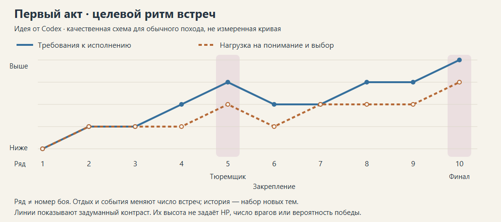

# Первый акт: переделка арен, составов и кривых — идея от Codex

**18.10.2026. Автор: Codex. Статус: подробное дизайн-предложение; не утверждено и не реализовано.**

Область — уже существующий лесной акт до перехода в гарнизон: 22 ID арен, включая два варианта Тюремщика. Пролог учитывается как предыстория обучения, но не переделывается; гарнизон и его уровни не входят в этот пакет. Это продолжение [первого аудита](codex-idea-act1-levels.md) и [исследования геометрии CoTL / Absolum / Isaac](reports/combat-geometry-cotl-absolum-isaac.md).

Документ предлагает единую версию развития прежних идей. Размеры и приоритеты из ранних заметок не складываются с ним в обязательный список всех переделок. При расхождении текущие правила определяет код и `realtime-*.md`; здесь описана возможная будущая версия.

Для подробного проектирования читать вместе с тремя приложениями:

- [22 карточки арен](research_notes/act1-redesign/arena-cards.md): текущая форма, конкретная переделка, маршруты, старт, пополнение и выход.
- [Составы и количественные рецепты](research_notes/act1-redesign/encounter-recipes.md): действующие способности, число носителей, сочетания и ограничения.
- [Аудит расписания и кривых](research_notes/act1-redesign/progression-audit.md): точные условия нынешнего порядка, история знакомств, исключения и варианты изменения.

**Визуализация:** [интерактивный атлас 22 арен / 26 вариантов](research_notes/act1-redesign/atlas/index.html), [все арены одной картинкой](research_notes/act1-redesign/atlas/overview.png), [легенда и крупные листы](research_notes/act1-redesign/atlas/README.md). Слои показывают первую группу, намерения маршрутов и области пополнения; есть сравнение с текущими авторскими шаблонами. Это эскизы для обсуждения, не реализованные уровни и не проверенный прогноз цепей.

## 1. Рекомендация

**Сохранить историю знакомств и приятный массовый проход по цепи. Переделывать встречу целиком: геометрию, начальную композицию и способ прихода следующих групп.**

У существующей игры уже достаточно материала: восемь особых лесных видов, местность, цели, элиты, атаманы и боссы. Проблема, которую проверяем, — насколько часто этот материал создаёт разные решения. Добавление атак всем врагам и общее увеличение HP для этой работы не требуются.

Предлагаются четыре изменения:

1. **Развести пространственные задачи.** Открытая поляна, обход препятствия, переход между площадками, выбор берега, маршруты между целями должны различаться в реальном бою, а не только на миниатюре.
2. **Дать составам роль.** Большинство тел поддерживает цепи; небольшое число особых врагов задаёт причину выбрать сторону, момент или конец прохода. Они входят в общее наполнение, а не добавляются поверх прежней массы.
3. **Отделить знакомство от комбинации.** Один новый противник с понятным местом на поле, затем его сочетание со знакомым. Знакомые по отдельности виды ещё не означают знакомую совместную задачу.
4. **Разнести рост требований.** После босса сначала возможность применить выученное, затем усиление знакомых сочетаний. Одновременное повышение прочности, числа особых видов и геометрической тесноты требует отдельного обоснования.

Не каждая карта должна стать сложнее. Несколько простых открытых встреч нужны для контраста, проверки сборки и удовольствия от больших цепей. Не каждую карту нужно увеличивать.

## 2. Что уже хорошо и что обнаружено в текущей системе

### 2.1. Сохраняем

- **Расписание по истории игрока**, а не только по номеру ряда. Оно уже поддерживает новое рядом со знакомым и необходимые предшествующие темы.
- **Разделение геометрии и ростера.** Есть база для вариантов одного поля; не требуется отдельный уникальный уровень под каждую пару видов.
- **Особые цели и существующие ответы.** Кнопка концом цепи, боковой подход к щиту, сила от жаровни, приоритет атамана, окно части босса.
- **Простой рядовой враг как полезное звено.** Повышать глубину можно через размещение и нескольких носителей угроз, сохраняя массовые убийства.
- **Различие обязательной задачи и решения остаться после неё.** Послегоаловый риск — отдельная ценность игры; не растягивать основную встречу ради него.

### 2.2. Текущий факт → дизайнерское следствие

| Сейчас | Что это означает для переделки |
|---|---|
| Обычный новый поход и Испытание I используют расписание; Испытание II+ и сохранения без него — другую ветку выбора | Нельзя задавать одну новую последовательность для всех режимов. Основной адресат пакета — новые походы с расписанием |
| Расписание выбирает первую готовую дугу; практика чаще появляется, когда готовой новой темы нет | Ограничение «одна новинка» ещё не создаёт ритм знакомства и закрепления |
| `glade`, `p-yard`, `p-archer-yard` наследуют одну геометрическую основу; окно повторов смотрит на ID | Разные названия способны дать почти одинаковые пространственные решения подряд |
| В 12 из 22 шаблонов нет авторских стартовых врагов; затем работает добор плотности | Тему арены может определять первый случайный набор. Нужна читаемая первая композиция, учтённая в общем наполнении |
| Обычная база пополнения — 28 с учётом живых, меток и очереди; периодические группы приходят дополнительно | Это не 28 гарантированно видимых врагов в момент старта и не фиксированный размер волны |
| До цели и после цели разные режимы давления | Нынешние послегоаловые фазы не являются готовым сценарием середины основной встречи |
| Большая арена увеличивает коэффициент наполнения максимум до 1,1, область появления остаётся около героя | Удлинение карты не создаёт самостоятельно вторую полноценную схватку |
| В обычных настройках четыре цвета с начала; палитра 2/3/4 по рядам — выключенная опция | Нельзя рассчитывать ранние рецепты как уже работающий бой в два цвета |
| На шестом ряду расписания верх HP крепких и обычное число пластин встреченной элиты могут перейти с 2 сразу на 4 | При новой комбинации или сложной геометрии это одновременный рост нескольких требований, а не гарантированно плавная ступень |
| Предел 2/3 особых видов ограничивает добавление партнёра; он не является общим фильтром любого фиксированного состава | Заставу и финалы нужно проектировать отдельно, а не считать автоматически уложившимися в этот предел |
| Финалы выбираются до обычной очереди тем; некоторые появления босса идут отдельным путём | Контроль новизны обычных комнат сам по себе не доказывает подготовленность к финалу |

Это подтверждённые свойства кода, но не доказательство, что каждый игрок испытывает перегрузку. Нынешнее числовое усиление имеет историю принятого балансного решения; предложение изменить его требует сравнения, а не оформления как исправления ошибки. Подробные ссылки и исключения — в [аудите](research_notes/act1-redesign/progression-audit.md).

## 3. Три разные кривые

**Сложность прохождения — насколько трудно выполнить задачу:** получить нужную позицию, успеть ответить, пережить ошибку, закончить бой имеющейся сборкой. На неё влияют урон, время ответа, скорость, перекрытие атак, запас здоровья, прочность целей и пространство для движения.

**Комплексити — сколько разных правил и взаимодействий нужно учитывать одновременно:** выбрать цвет и силу цепи, обойти щит, не закончить проход у сапёра, попасть к кнопке, следить за меткой лучника. Три одинаковых лучника могут создавать высокое давление с одним знакомым ответом; один шаман рядом со щитом и целью-кнопкой может требовать больше разных решений.

**Новизна — что игрок встречает впервые:** вид, цель, местность, сочетание или пространственная ситуация. Запись `seen` подтверждает встречу по правилам учёта, а не уверенное освоение. Известный враг в новом сочетании способен снова повысить комплексити.

Числовые изменения не всегда «чистая сложность»: дополнительное HP может менять допустимый порядок звеньев; дополнительная пластина — число необходимых заходов. Геометрия тоже не бесплатна: остров одновременно добавляет обход и разрывает видимость между целями.

### 3.1. Рабочие ограничения встречи

Это предложения для дизайна, не универсальные когнитивные константы и не действующие лимиты движка.

| Тип встречи | Новое | Что держать на переднем плане | Что допускается усиливать |
|---|---|---|---|
| Первое знакомство | Одна тема | Новый ответ и привычная цепь; знакомый партнёр только если помогает теме | Авторская ясность положения, а не скорость/HP нового врага |
| Закрепление | Нет обязательной новой темы | Тот же ответ в другом расположении | Второй носитель, другой подход или знакомая пара — один основной рычаг за раз |
| Комбинация | Новое взаимодействие знакомых элементов | Две взаимосвязанные угрозы/задачи | Выбор приоритета и конца цепи |
| Трудная встреча | По возможности нет новой боевой темы | Знакомая комбинация с менее выгодной позицией | Подкрепление, элита или числовое давление при сохранённом ответе |
| Босс | Новые приёмы босса допустимы | Читаемая атака → возможность ответа; знакомый материал вокруг | Эскалация его цикла, а не случайная смесь дополнительных уроков |
| Разгрузка | Нет | Быстрые цепи и применение сборки | Награда за эффективность; бой может закончиться очень быстро |

Количество присутствующих типов, количество особых тел и количество одновременно опасных ответов записывать отдельно. Лимит живых спецврагов не является гарантией, что их атаки никогда не совпадут. Глобальная очередь разрешений на атаки — самостоятельная возможная система, не скрытая зависимость этого пакета.

## 4. Как переносим референсы

| Источник | Подтверждённая основа | Решение для нас | Ограничение |
|---|---|---|---|
| CoTL | Отдельные заготовки формы и встречи, подготовленные точки волн | Небольшой каталог форм с несколькими совместимыми составами и областями пополнения | Точные prefab-контуры не извлечены; наши планы не называем копиями комнат CoTL |
| Isaac | Комнаты разных форм; разное внутреннее устройство в одном габарите | Остров, выступ, смещённые проходы, открытый центр с опасными краями | Не переносить плотную россыпь ям и камней, разрывающую близкие одноцветные цели |
| Absolum | Сужение/раскрытие, широкие подходы, препятствие у края, несколько участков сцены | Короткая связь между полноценными площадками и смена направления продвижения | Не растягивать ту же толпу на длинную горизонтальную полосу |

Источники и точные сцены разобраны в [исследовании](reports/combat-geometry-cotl-absolum-isaac.md); формы Isaac также отражены в [RoomShape API](https://wofsauge.github.io/IsaacDocs/rep/enums/RoomShape.html), авторские варианты участков Absolum описаны в [официальном devlog](https://store.steampowered.com/news/app/1904480/view/793318320683090046). Референсы помогают выбрать устройство встреч, но не обосновывают наши числа врагов.

### 4.1. Геометрические семьи акта

| Семья | Основная работа игрока | Применение |
|---|---|---|
| Открытое ядро | Собрать хороший проход и выбрать конец | `glade`, `marked`; простая встреча должна остаться в акте |
| Асимметричный край | Выбрать сторону входа в группу | `p-yard`, `p-archer-yard`, часть `shields` |
| Смена площадки | Провести бой через короткое горло, сохраняя манёвр | `p-gorge`, часть поздней Заставы |
| Развилка вокруг преграды | Выбрать фланг и приоритет цели | `shaman-circle`, `archers` |
| Два берега | Сравнить короткий рискованный путь и доступную альтернативу | `p-cliff`, `p-river`, `ford`, `powder` — у каждой свои действующие свойства местности |
| Несколько мест для завершения цепи | Спланировать следующую задачу и выход из текущей | `buttons`, `thorns` |
| Опора на полезный объект | Выбрать жаровню и маршрут силы | `p-braziers`, `shields`, подходы к частям Тролля |
| Большая кульминационная площадка | Менять позицию в цикле босса/финальной схватки | `jailer`, `jailer-yard`, `troll`, `last-stand` |

Геометрические семьи могут пересекаться, но у каждой встречи должна быть одна главная пространственная задача. Новое название, цвет земли или зеркальное отражение сами по себе не создают новую задачу.

### 4.2. Ограничения размеров и проходов

- Размеры в карточках — стартовые гипотезы, а не новые нормы. Сначала пробовать нынешний габарит, если задача в нём помещается.
- Проход должен вмещать подготовку цепи и уклонение с учётом размеров тел; его ширину нельзя выбирать только по тому, проходит ли один герой.
- Расстояния между предполагаемыми звеньями сверяются с реальным радиусом и видимостью. Увеличение поля не увеличивает радиус цепи.
- У опасной переправы отдельно проверить шаг, прыжок и цепь по действующим правилам; не обещать способ пересечения только по рисунку.
- У каждого обязательного участка должен оставаться достижимый ответ после частичной зачистки. Изначальная удачная цепь не доказывает проходимость оставшегося боя.
- Камера, видимость важной угрозы и время до следующего полезного действия — основания уменьшить карту, даже если её общий план красив.

## 5. Что делать с каждой существующей ареной

Это сводная производственная таблица. Полная текущая геометрия и конкретные предложения по каждой записи — в [22 карточках](research_notes/act1-redesign/arena-cards.md). Рецепт состава выбирается отдельно для первого знакомства и повторной встречи.

| ID | Предлагаемая роль в акте | Основное изменение | Что сохранить |
|---|---|---|---|
| `glade` | Базовая цепь, первое знакомство с волками/кабаном, разгрузка | Несколько читаемых стартовых композиций для разных учебных тем | Открытое ядро и быстрый бой; не превращать в полосу препятствий |
| `p-yard` | Практика известного состава | Выступ у края или асимметричная открытая площадка | Простую цель; отсутствие новой обязательной механики |
| `p-gorge` | Практика смены направления | Две площадки и короткое широкое соединение; места групп по обе стороны | Возможность принять бой и возможность продвинуться |
| `p-braziers` | Маршрут силы | Различимые подходы к жаровням; цель, для которой бонус действительно полезен | Несколько способов получить достаточную силу; без всеобщего повышения HP |
| `p-cliff` | Выбор переправы | Две полноценные стороны, короткий участок пересечения и понятный сухой обход | Обрыв как реальное свойство местности, а не декоративную черту |
| `shields` | Первый боковой заход и его закрепление | Щит связан с доступной жаровней, другой фланг оставляет обычный обход | Текущие правила щита; дополнительная атака не обязательна |
| `buttons` | Планирование конца цепи | Три доступные области вокруг целей, материал для следующего перехода | Кнопка берётся концом цепи; свободный порядок |
| `p-archer-yard` | Первый прицел и смена позиции | Препятствие у края и открытый фланг; лучник виден и достижим | Стену не объяснять как защиту от уже поставленной точечной метки |
| `powder` | Выбор места убийства и выхода из взрыва | Расселина оставляет большую площадку для отхода, сапёр не запирает единственный маршрут | Существующий взрыв и последствия; падение сапёра не подменять взрывом |
| `archers` | Приоритет атамана | Два читаемых подхода к одному атаману; помехи не симметричны | Текущую цель markedGoals, а не старое «убить трёх отмеченных» |
| `p-river` | Знакомство с замедлением/пересечением воды | Достаточные площадки у берегов, группы для смены стороны | Воду не превращать в пропасть; её текущий способ прохождения |
| `lynx-den` | Ответ на прыжок, затем работа с двумя рысями | Открытая зона бокового шага и разные начальные подходы | Окно после прыжка; не требовать нового ИИ для первого опыта |
| `p-thicket` | Знакомство с изгородью | Короткий читаемый участок и ясный обход | Не добавлять одновременно дикобраза и новую цель |
| `thorns` | Сочетание кнопок и ограничения маршрута | Дикобраз затрудняет один заход, остальные направления остаются полезными | Доступность всех трёх кнопок после частичной зачистки |
| `shaman-circle` | Решение о приоритетной поддержке | Два подхода вокруг небольшого центрального препятствия, полезные жаровни | Один главный атаман-шаман; не требовать нового «сломанного посоха» |
| `marked` | Большой проход и работа с крепким краем | Читаемый подход к орде до её смешения с обычным притоком | Орду из 12 двух цветов и право сильной сборки быстро закончить бой |
| `ford` | Знакомая вода плюс давление при переправе | Два разных участка подхода, промежуточные звенья у берега | Нынешнюю большую арену и цель атамана; сухой обход не существует по умолчанию |
| `outpost` | Необязательный трудный бой и риск ради сундука | Роли входов, щита и стрелка; известные составы по рецепту | Право выполнить цель снаружи и отказаться от сундука |
| `jailer-yard` | Первое освоение части босса без обрыва | Читаемый подход к гире и место после прохода | Вариант без обрыва; снятие щита ядра при незнакомом щитоносце |
| `jailer` | Та же проверка с известной местностью | Связать край, гирю и доступную толпу, сохранив путь уклонения | Не делать новый бой вместо знакомого босса |
| `troll` | Кульминация через части и окна | Доступность цепи к открытому окну, запас пространства после атак | Текущий цикл и прекращение боя после смерти босса; отдельный аудит призыва волков |
| `last-stand` | Нынешняя финальная смешанная встреча | Разные решения у открытого берега и руин, ограниченный набор знакомых спецов | 40 убийств; не выдавать послегоаловые фазы за волны до цели |

`p-*` не означает автоматически «только практика»: ряд этих ID используется как первое знакомство. В частности, новый план `p-archer-yard` должен оставаться понятным для первого лучника. Первую версию карты и более насыщенную версию повторной встречи проектировать отдельно.

Главарь из [отдельной спеки](task-54-chief.md) остаётся самостоятельной работой. Этот пакет не изображает его уже реализованным и не требует закончить его ради проверки геометрии рядовых арен.

## 6. Начальная композиция и пополнение — один замысел

У каждой переделанной встречи нужны три описания: **что игрок видит сначала; что остаётся после первой сильной цепи; откуда и в каком составе приходит следующая группа**. Стартовая картинка без второго и третьего состояния недостаточна.

Предлагаемая последовательность проектирования:

1. Выбрать главную задачу и один основной особый тип; на знакомстве остальных специальных носителей оставить только при понятной пользе.
2. Разместить доступный материал для цепей рядом с реальными подходами. Цвета, крепкие и специальные носители проверять вместе; не считать любое скопление полезной цепью.
3. Выделить совместимые области пополнения: ближайший подход, дальняя площадка, боковая поддержка. Это дизайнерские области, а не обязанность врага вечно стоять в них.
4. Проверить, куда действующий ИИ сведёт врагов после нескольких секунд и проходов. Нельзя обещать устойчивые лагеря без поведения, которое их удерживает.
5. После зачистки одной стороны дать следующую осмысленную ситуацию. Если предполагается перенос давления вперёд, его условия и влияние на заднее пополнение — отдельное новое правило.

Для нового пополнения нельзя просто выбрать «реже» или «меньше». Когда спецтип временно не разрешён составом, его место занимает обычное тело; число доступных звеньев сохраняется. Изоляция особого врага от всей толпы тоже не универсальное решение: герой может остаться без пути к нему.

**Очередь и метки учитываются вместе с живыми.** Предлагаемый лимит спецтипа должен резервировать уже запланированных носителей; иначе при массовом убийстве добор очереди создаст несколько лишних экземпляров. После смерти спецврага новый не должен мгновенно появляться в конце текущей цепи: использовать читаемое существующее предупреждение и подходящее место.

Проблема переноса метки рядом с героем уже [исследована отдельно](codex-idea-enemy-behavior-variety.md). Новая геометрия не считается рабочей, если пополнение можно бесконечно задержать стоянием у её допустимых точек. При этом дизайн не разрешает внезапное появление без предупреждения.

## 7. Количества: что именно ставить в бой

### 7.1. Как читать числа

**B** — обычные тела, включая слабых и крепких. **W** — отдельные волки; стая из трёх занимает три места. **E** и **L** — статусы элиты и атамана внутри соответствующих тел, не дополнительные враги. Часть босса учитывается отдельно.

**A** — авторская группа, видимая при старте. **F** — нижняя граница общего наполнения с учётом живых, меток и очереди. A входит в F. Значение F=28 не означает 28 живых на нулевом кадре. Периодические группы сохраняются, поэтому население может расти выше F; обычный действующий предел — 60, на достаточно большом поле — 66.

В таблицах ниже задан **предлагаемый срез при заполненных специальных слотах**, а не обещание неизменного количества в каждый кадр. Между F и пределом дополнительные места в этом варианте получают B. Если специального тела нет, его место временно также занимает B. Это сохраняет массу, но меняет состав и может облегчить давление — последнее нужно проверить, а не считать автоматически сохранённым балансом.

Точные ограничения и интервалы в приложении — новые правила для прототипа. Нынешние проценты не умеют гарантировать эти количества. Можно начать с авторских первых групп без нового пополнения, но тогда проверяется только читаемость старта, не весь предлагаемый бой.

### 7.2. Первое знакомство

Для обычного габарита F=28; при достигнутом коэффициенте большой арены F=31 добавляются три B, а число спецврагов не растёт автоматически.

| Тема | A: первый видимый эпизод | Срез при F=28 | Предлагаемое ограничение до цели |
|---|---|---|---|
| Основа | 9B | 28B | Особых видов нет |
| Волк | 6B + 3W | 25B + 3W | Одна тройка; следующая целая стая после освобождения мест, не чаще заказа раз в 8 с |
| Кабан | 8B + 1 кабан | 27B + 1 кабан | Один носитель, заказ не чаще 8 с |
| Лучник | 8B + 1 лучник | 27B + 1 лучник | Один носитель, заказ не чаще 6 с |
| Щит | 8B + 1 щит | 27B + 1 щит | Один носитель, заказ не чаще 6 с |
| Сапёр | 8B + 1 сапёр | 27B + 1 сапёр | Один носитель, заказ не чаще 6 с |
| Рысь | 8B + 1 рысь | 27B + 1 рысь | Один носитель, заказ не чаще 6 с; это отдельная учебная версия вместо нынешних двух стартовых рысей |
| Дикобраз | 8B + 1 дикобраз | 27B + 1 дикобраз | Один носитель, заказ не чаще 8 с; местность и кнопки уже известны |
| Шаман | 8B + 1 атаман-шаман | 27B + 1 шаман | Пока атаман жив, других шаманов нет; после его смерти цель выполнена, нового атамана не создаём |

Интервал означает минимальное время **между заказами** этого типа в игровых секундах. Он не задерживает обычных врагов и не управляет временем атаки. Избыток специального броска превращается в B; нельзя ставить ожидающего спецврага в начало общей очереди и блокировать всю толпу.

Первой элите отдельный эпизод: **1 basic-элита с двумя пластинами + 8–10 обычных B**; элита уже входит в общее число basic. На первой элите не нужно одновременно объяснять новый вид или аффикс. Если в другой учебной встрече текущие правила требуют знакомую гарантированную элиту, она остаётся отдельной нагрузкой: один из B может быть E, но это не делает встречу столь же простой, как без неё. Перенос момента гарантии за первый понятный эпизод — самостоятельная предлагаемая правка, не доступная автоматически настройкой количества.

Жаровня, обрыв, вода и терновник получают **6–8 доступных слабых и 1–2 крепких B** в первой композиции, остальное — добор. Особый знакомый партнёр нужен только когда усиливает тему. Не повышать число цветов, HP, число типов и сложность контура одновременно с новым свойством местности.

### 7.3. Закрепление и комбинации

| Встреча | Срез состава | Зачем сочетать именно этих врагов |
|---|---|---|
| Знакомая стая | 24B + 4W = 28 | Повтор коллективной угрозы с другим направлением подхода |
| Два кабана | 26B + 2 кабана = 28 | Тот же боковой ответ, но две разнесённые линии; не два обязательных одновременных удара в узком горле |
| Щиты и стрелок | 25B + 2 щита + 1 лучник = 28 | Выбор угла входа сочетается со сменой конечной точки |
| Стая и стрелок | 24B + 3W + 1 лучник = 28 | Решить, сорвать ли вой сейчас или раньше убрать прицел |
| Шаман и щиты | 25B + 1 шаман + 2 щита = 28 | Найти подход к источнику усиления либо убрать усиливаемые тела |
| Рысь и стрелки | 25B + 1 рысь + 2 лучника = 28 | Уход от полосы прыжка и выбор безопасной посадки цепи |
| Иглы и порох | 25B + 1 дикобраз + 2 сапёра = 28 | Использовать взрыв на группе и не включить опасное звено автоматически |
| Поздняя тройная смесь | 24B + 2 щита + 1 лучник + 1 кабан = 28 | Три знакомых запроса; только после пар, при свободной площадке для ответа |
| Стрелковая гряда | 25B + 3 лучника = 28; один из трёх — L | Продвинуться к важной цели или снять обычного стрелка по пути |
| Брод | 25B + 3W + 3 лучника = 31; один стрелок — L | Выбрать участок переправы и использовать подошедшую стаю |
| Застава | 35B + 2 щита + 2 лучника = 39; E = один щит и один лучник внутри этих четырёх | Трудная известная пара на более сложных подходах; количество видов не нужно поднимать до четырёх |

Цифры большой Заставы используют текущие множители `28 × 1,1 × 1,25` с округлением. При другом размере и режиме F пересчитывается; например, трудный бой на 16×10 имеет F=35. Рецепт не переносится автоматически в Ash V с дополнительным масштабированием или на особую толпу босса.

Для `marked` сохранить 12 отмеченных B **внутри** общего наполнения. Вариант с одной знакомой рысью — 27B + 1 рысь, причём 12 из 27B являются целью. Новых отмеченных после их убийства не добавлять. Нельзя понимать «атаман» как дополнительную элиту: это другое свойство цели.

### 7.4. Какие сочетания не делать базовыми

- **Шаман + щит + дикобраз в тесном месте:** несколько ограничений на одну и ту же цепь, слабая возможность сменить подход. Сначала испытать пары на открытом поле.
- **Две рыси + несколько кабанов в горле:** привычные по отдельности ответы могут перекрыть друг друга пространственно. Дополнительные B не гарантируют доступного выхода.
- **Сапёр у каждой кнопки:** превращает свободный порядок целей в повтор одной обязательной проверки. Одной осложнённой зоны достаточно.
- **Аффикс «Хамелеон» при первом шамане или первом щите:** одновременно меняются несколько оснований выбора цепи. Новая разновидность аффикса должна считаться новой темой, даже если общий флаг `affix` уже знаком.
- **Дальняя группа стрелков за непроходимым карманом:** создаёт давление без доступного ответа. Дистанция должна компенсироваться подходом, промежуточными звеньями или действующим альтернативным действием.

«Щиты и стрелок» — пространственное сочетание, а не уже существующий защитный строй ИИ: щиты сейчас не удерживают специально заданную линию перед лучниками. Сапёр может помогать игроку взрывом толпы; добавление сапёра не всегда повышает трудность. Полная матрица и разбор действующих ответов — в [рецептах](research_notes/act1-redesign/encounter-recipes.md).

## 8. В каком порядке вводить

### 8.1. Вариант A: сохранить расписание, улучшить содержание его шагов

**Рекомендуемый первый объём.** Сохранить нынешний порядок и его условия: волк → готовая элита / жаровня → обрыв → кабан → вода → щит → кнопки → лучник → сапёр → атаман → рысь → аффикс → терновник → дикобраз → шаман → орда. Элита ждёт минимум третьего боя и четвёртого ряда; это очередь готовности, не список по одному на ряд. Тюремщик, трудный узел и финал имеют собственные ветки.

Каждый шаг получает свой рецепт знакомства и варианты закрепления. Точные места и составы отбираются по известным элементам; новая тема не выдаётся парой с другим неизвестным типом. Варианты из §7 не разрешают раннего шамана только потому, что его рецепт готов.

Улучшения поверх этого каркаса предлагать отдельно:

- **Повторение семьи, а не только ID.** В практике выбирать другую главную пространственную задачу, если есть подходящий вариант. Учебный шаг важнее антиповтора: знакомство с лучником можно оставить на открытом поле, даже если предыдущая Поляна тоже была открытой.
- **Короткое закрепление.** После двух встреч с новыми темами подряд следующий доступный обычный бой может повторить последнюю в другом расположении. Особенно после новой цели или правила, меняющего цепь. Не вставлять новые узлы и не удлинять поход; часть тем естественно переносится в следующие походы.
- **Контроль исключений.** Событие с первой элитой и новый тип аффикса учитывать при выборе учебной нагрузки, не считать их бесплатными.

Минимальная геометрическая проба не требует сразу менять планировщик. Caps, интервалы специальных заказов, антиповтор семей и бой закрепления — отдельные новые правила. Проверять пользу каждого, а не связывать всё в неделимый релиз.

### 8.2. Вариант B: несколько учебных веток вместо одной длинной очереди

**Более смелая альтернатива**, если первый вариант сохраняет слишком одинаковое начало разных походов. Сохраняются история, ограничения новизны, карта и все существующие цели. Из готовых учебных веток выбирается подходящая по истории и seed узла; речь не о подстройке врагов под урон сборки или движение мыши.

| Ветка | Порядок и смысл |
|---|---|
| Массовая цепь | Основа → стая → знакомая элита → орда как применение силы |
| Угол и приоритет | Жаровня → щит; лучник → атаман; затем знакомые щит + лучник |
| Переправа и взрыв | Обрыв → сапёр; вода → переправа под знакомым давлением |
| Направление атаки | Кабан → рысь как родственный ответ на полосу; затем рысь + лучник |
| Конец цепи | Кнопки + терновник → дикобраз → выбор осложнённого или свободного подхода |
| Поддержка | Жаровня + атаман → шаман → шаман + знакомый щит |
| Модификаторы | Знакомая элита → практика → один новый тип аффикса |

Не обязательно пройти все ветки в одном акте. Пререквизиты щита, сапёра, атамана, дикобраза и шамана сохраняются; новая связь кабан → рысь — отдельная гипотеза. Ветки не должны превращать карту в обязательный учебный коридор. Слишком короткий путь получает меньше новых тем, а не дополнительные принудительные бои.

Примеры **проектируемых** путей, не результаты нынешнего генератора:

| Профиль | До Тюремщика при четырёх подходящих боях | После Тюремщика |
|---|---|---|
| Новичок, ветка силы | Поляна → волк → жаровня → первая элита | Практика знакомого → щит → один новый приоритет при наличии места → финал с подходящим окружением |
| Новичок, ветка перемещения | Поляна → волк → обрыв → кабан | Практика → первая элита → сапёр либо вода; не догонять все остальные темы перед финалом |
| Опытный профиль | Знакомая пара на простом поле → известная местность → знакомая элита → более свободная цепь | Новое сочетание известных видов → трудный бой по выбору → знакомый прорыв → финал |

Во втором примере готовая элита намеренно уступает кабану; нынешний вариант A так не выбирает. Небоевой узел сдвигает тему, а не заменяется боем. После поражения знакомства сохраняются по нынешнему контракту, но новый вариант может предложить спокойное повторение вместо немедленной сложной пары. Не вводить обязательную проверку «мастерства», блокирующую продвижение.

Для старого профиля с большим `seen` не запускать полный курс заново. Дополнительные сведения о практике, если понадобятся, не считать доказанными задним числом и не превращать их отсутствие в наказание игрока. Общая история кота и Ведуньи не гарантирует одинакового умения использовать их текущие особенности.

## 9. Предлагаемый ритм difficulty и complexity

### 9.1. Кривая по участкам

Это целевой ритм, а не измеренный график нынешнего баланса. Ряд задаёт место в походе; внутри него может не оказаться обычного боя. Значения сложности относительно сборки и опыта проверяются плейтестом.

[Схема в SVG](research_notes/act1-redesign/target-rhythm.svg). Высота линий качественная: это иллюстрация контраста и закрепления, не общий рейтинг или формула баланса. Для знакомого профиля новизна будет ниже, хотя сложные сочетания сохраняют нагрузку на выбор.

| Участок | Difficulty: что требуем | Complexity: что разрешаем | Контраст |
|---|---|---|---|
| Ряд 1 | Быстро начать цепь и выполнить простую цель | Базовое чтение; для ветерана возможен знакомый рецепт | Простор, понятная первая группа |
| Ряды 2–3 | Ответить на одну угрозу или свойство местности | Одна тема, затем знакомое применение | Меняется сторона/маршрут, не все числа сразу |
| Ряд 4 | Небольшая проверка силы и подхода; первая элита при готовности | Знакомое поле, одна новая система | Локальный пик перед контрольной встречей |
| Ряд 5, Тюремщик | Прочитать приём, доставить цепь к части, выйти | Новая часть босса на подготовленном окружении | Отдельный пик; не считать его отдыхом |
| Первый бой после Тюремщика | Применить сборку и прежний ответ | Знакомое сочетание, без обязательной новинки | Снижение нагрузки на чтение, не обязательное уменьшение всей толпы |
| Остальные бои 6–7 | Удержать позицию в паре знакомых угроз либо освоить один поздний тип | Пара или новая тема; не их сумма | Перемежать открытое и маршрутное поле |
| Ряд 8 | Более интенсивное известное сочетание | Два вида обычно; третий — осмысленный трудный вариант | Возможность выбрать риск через маршрут похода |
| Ряд 9, прорыв | Собрать знакомые ответы в уверенный бой | Не вводить недошедший вид ради полноты каталога в предлагаемой версии | Подготовка к финалу, а не ещё один учебник |
| Ряд 10 | Пройти цикл босса или текущую финальную встречу | Босс может быть новым; вспомогательные угрозы преимущественно известны | Кульминация, после которой не нужна дополнительная орда |

На знакомстве difficulty может вырасти умеренно при заметном росте новизны. На закреплении новизна падает, а интенсивность может вырасти. После босса полезно снизить комплексити, даже если HP героя/сборка позволяют держать высокий темп. Поэтому обе кривые не должны быть одинаковой лестницей вверх.

### 9.2. Числовая кривая: оставить контроль и сравнить альтернативу

Усиление текущего расписания компенсировало снижение нагрузки от ограниченной новизны. Нет основания заранее объявлять его ошибкой. **Контрольный вариант — нынешние числа; новые композиции сначала сравниваются при них.**

Если реальные бои покажут скачок после Тюремщика, предлагается отдельная проба «разнесённые ступени» для обычных врагов и знакомых элит Ash 0/I:

| Ряд | Сейчас: пластины / верх HP крепких | Кандидат для сравнения: пластины / верх HP | Что изолируем |
|---|---|---|---|
| 1–5 | 2 / 2 | 2 / 2 | Сохраняем раннюю числовую базу |
| 6 | 4 / 4 | 3 / 2 | Сначала один дополнительный заход к элите |
| 7 | 4 / 4 | 3 / 3 | Затем более требовательные звенья в толпе |
| 8 | 4 / 4 | 4 / 3 | Следующий шаг знакомой элиты |
| 9–10 | 4 / 4 | 4 / 4 | Выход на нынешний поздний уровень |

Это конкретный кандидат основного документа; более простой вариант 3/3 на 6–7 из приложения остаётся альтернативой, а не ещё одной одновременно действующей таблицей. Первая элита по-прежнему 2 пластины; броня и HP боссов этой таблицей не меняются. Общая палитра, касание, неуязвимость, скорость и плотность в этой пробе не перенастраиваются.

Нельзя принимать таблицу только потому, что урон уменьшился. Если сборка стала слишком быстро заканчивать все обычные встречи, проверить число осмысленных эпизодов, роль цели и силу наград. Не возвращать сложность случайными четырьмя видами и не увеличивать HP всем врагам. Право сильной сборки завершить бой быстро сохраняется.

### 9.3. Сложность похода и сила сборки

Сложность одной арены не равна сложности похода. Несколько умеренных встреч без восстановления способны стать тяжёлым отрезком; трудный узел после отдыха воспринимается иначе. В сравнении фиксировать полученный урон, запас HP на входе, награды, расходники и выбор пути.

Не подгонять каждого врага под текущий урон героя. Игрок должен чувствовать выигрыш от сборки. Баланс проверять минимум на слабой, обычной и удачной сборке; если карта работает только когда у игрока мало силы и он обязан увидеть каждый задуманный эпизод, такой сценарий слишком жёсткий.

Повторный поход не обязан стать таким же учебным, как первый: сложность может расти сочетаниями знакомого при меньшей новизне. Испытания II+ сохраняют свою отдельную систему до отдельного решения. Пятый цвет на высоком Испытании — изменение чтения и доступности цепей, не просто числовая надбавка урона.

## 10. Финалы и исключения нужно подготовить отдельно

### Количества в боссах нельзя брать из обычного рецепта

При стандартном новом походе, без дополнительных модификаторов:

| Бой | Проверенные числа сейчас | Предлагаемая первая композиция |
|---|---|---|
| Оба Тюремщика | Ядро + гиря; floor большого поля 31, и эти две сущности входят в счётчик. Свисток второй фазы даёт 4 обычных тела у дальних ворот, таймер 12 с; прямой призыв отдельно от обычного предела | 8B + ядро + гиря = 10 авторских тел. Пять B у ближнего подхода, три у другого раскрытия; остальное добирается до действующего floor. Не добавлять специальных видов |
| Тролль | Ядро + 3 части. Арена заменяет стандартный `trollCrowd=1` на **0,3**; при базовых настройках floor = round(28×1,1×0,3) = **9**, включая ядро/части. Обычный интервал групп растягивается примерно до 10–16,7 с. Рык со второй фазы ставит по волку у трёх входов, пока живых+меток волков меньше 4; таймер 20 с | Сначала испытать 3B + ядро + 3 части = 7 авторских тел: три B у первого подхода к лапе; соседний подход поддерживает обычное пополнение. Рык и предел 4 волков сохранить как контроль; не добавлять лучников/шамана ради финальности |

Источники: [выбор параметров арены в world.ts](../../src/realtime/sim/world.ts), [учёт floor и множителя в spawn.ts](../../src/realtime/sim/spawn.ts), [свисток](../../src/realtime/sim/enemies/jailer.ts), [рык и `TROLL_CROWD`](../../src/realtime/sim/enemies/troll.ts). Это расчёт настроек и состава, не замер видимых живых в бою. Прямой призыв может превысить обычный floor; после исчезновения части распределение добора меняется. Таймеры 12/20 с не гарантируют точного интервала фактического выхода: приём и замах могут его сдвинуть. Прямые призывы обычные (`plain`); B из общего пополнения могут стать знакомой случайной элитой по правилам похода.

На первом такте `groupTimer=0`: сначала заказывается периодическая группа 2–4, затем добор до floor. Поэтому предложенный A=7 Тролля даёт резерв 9–11 уже после первого такта (5–7 B с учётом меток/очереди и четыре боссовых сущности), а не остаётся семью телами. Это расчёт без действий игрока и иных модификаторов, не наблюдение кадра. Ставить сразу 5B+4 сущности означало бы сознательно получить 11–13 после этого заказа; такой дополнительный рост здесь не выбран.

**Отдельный риск Тролля:** части и призванные волки занимают места в общем счётчике, поэтому большой размер карты не означает много обычных звеньев около каждого окна. Сначала сравнить расположение трёх авторских B и последующего обычного добора при нынешних правилах пополнения. Только если реальные действия покажут систематически пустые окна, отдельно испытать резерв минимум пяти обычных B (живые+метки+очередь), который не поглощается частями/волками. Это увеличивает доступное наполнение относительно нынешнего общего floor и способно облегчить босса; не включать такой резерв без отдельного сравнения. Существующий успешный способ ударить ядро/часть также учитывается: цепь через всю толпу не обязана быть единственным ответом.

### Тюремщик

Существующий выбор двора без обрыва и ядра без щита при соответствующей истории — полезный образец. Сначала улучшать читаемость гири и доступность пути к ней. Новые атаки не нужны, чтобы исправить формальное окно, до которого невозможно дотянуться имеющимися звеньями.

### Тролль

Проверить три вещи: игрок понимает текущий приём; после ответа есть материал для цепи к доступной части; конец прохода не гарантирует немедленное попадание. Толпа, снесённая атакой босса, может лишить игрока обещанного окна — такое окно не считается содержательным только по таймеру.

Волки рыка создаются отдельным путём и не гарантированно исключаются общей фильтрацией незнакомых видов. Предложение: при незнакомом волке заранее показать стаю в доступной обычной встрече **либо** сделать для такого финала отдельный ограниченный первый показ рыка с понятным материалом для ответа. Не заставлять карту вставлять дополнительный бой и не выключать рык молча как будто это текущая логика.

### Последний рубеж

Сохранить цель 40 убийств; до появления Главаря улучшать существующую встречу. Для первого финала достаточно двух знакомых специальных ролей на разных подходах. Предлагаемый пример при F=31: **27B + 2 сапёра + 2 дикобраза**, E — один из сапёров и один из дикобразов; только если оба вида известны. Если один неизвестен, заменить его тела подходящими знакомыми или B, сохранив счёт элит и массу. Три знакомых вида — отдельный поздний вариант, а не обязательный финал новичка.

Вода, жаровни и другие вспомогательные элементы финалов не фильтруются одним `withoutKinds`. Для короткого пути нужен совместимый вариант окружения: незнакомая опасная местность не перекрывает обязательный ответ, знакомая механика помогает; незнакомый полезный объект может оставаться необязательной возможностью. Это предложение к версиям финальных арен. Не переписывать граф `forest/` ради обязательного знакомства со всеми темами.

### События, аффиксы, этап после цели

Событийная первая элита и новый тип аффикса входят в общую нагрузку встречи. Если они уже заданы выбором события, обычную новинку лучше отложить в предлагаемой версии. Это не изменение цены или исхода самого события.

Текущую таблицу роста общей массы после цели сохранить как контроль. Для вводной версии предлагается оставить те же спецлимиты до выхода, чтобы добровольное промедление не превращалось в несколько новых уроков. Для знакомых встреч вариант постоянных caps из приложения — только отдельная проба: обычные B могут усиливать выгодные цепи, поэтому рост их числа не гарантирует рост опасности. Если риск слишком падает, проектировать эскалацию знакомых специальных носителей отдельно, с конкретными числами по фазам. Не переносить новые предцелевые правила на все послегоаловые фазы автоматически.

Боссы с `bossClears` заканчивают бой; им не добавляется общий этап жадности. Сундук Заставы остаётся необязательным. Игрок вправе покинуть обычную арену сразу после выполнения цели.

## 11. Порядок работы и варианты объёма

### Пакет 1 — доказать пользу композиции

**Три опытных арены, без новых атак и смены порядка расписания:**

1. `p-archer-yard`: препятствие у края, один лучник в первом показе; сравнение с нынешней открытой версией.
2. `shaman-circle`: на знакомом шамане сравнить практическую версию с островом и двумя подходами; на первом знакомстве оставить открытый центр/нынешнее дерево и проверить одного главного шамана с доступными звеньями. Новый вид и новая сложная форма не обязаны появляться вместе.
3. `p-gorge`: две площадки с короткой связью; сравнение, возникает ли причина переносить бой.

Сначала авторские композиции и текущие числа. Затем, если случайный добор уничтожает нужную ситуацию, прототип количественного состава и областей пополнения. Для каждой арены записать вклад отдельно: контур, первая группа, последующее пополнение. Не объявлять удачей красивый нулевой кадр.

### Пакет 2 — перенести работающие принципы

При успешной проверке: `p-braziers`, `p-cliff`, `buttons`, `shields`, `powder`, затем `archers`, `lynx-den`, `thorns`, `ford`. Простые `glade` и `marked` оставить контрастом; `p-yard` достаточно небольшого изменения формы. `p-river` и `p-thicket` сохранять прежде всего ясными первыми встречами.

Отдельно проверить босса и финалы на доступность ответа и неподготовленную новизну. Эти проверки важны независимо от успеха большой переделки геометрии.

### Пакет 3 — выбрать необходимость изменения расписания

Если составы и карты уже дают разные решения, достаточно варианта A. Если начало разных походов продолжает повторяться, испытать B на существующих узлах. Числовую альтернативу §9.2 проверять отдельным сравнением: иначе невозможно понять, улучшила ли бой карта или его просто облегчили.

**Не требуется для этого пакета:** новые атаки всем видам, новая Ведунья с фигурами, новые артефакты, ранение с отключением частей рядовых врагов, новый HUD, замена всего генератора, обязательное увеличение всех арен. Их отдельные концепты не считаются внедрёнными зависимостями.

## 12. Как проверять и когда отказываться от идеи

### 12.1. Матрица проверки

| Измерение | Минимальные случаи |
|---|---|
| Опыт | Пустая история с прологом; пропущенный пролог; частичная история после поражения; знакомый профиль |
| Путь | Короткий с отдыхом/находками; много боёв; добровольный трудный узел; обе финальные ветви |
| Герой | Текущий кот и текущая Ведунья; концепт новых фигур не использовать для оправдания карты |
| Сборка | Слабая, типичная и сильная; запас HP/расходников фиксировать |
| Случайность | Несколько seed по `Math.imul(k, 2654435761) >>> 0`; не требовать, чтобы каждый исход отличался |
| Стадия | Старт → первая длинная цепь → частичная зачистка → первое пополнение → выполненная цель → выход; для босса собственный цикл |

### 12.2. Наблюдаемые критерии

- Игрок может назвать, чем эта встреча отличается и какой ответ помог; наличие двух путей на плане ещё не подтверждает выбор.
- Есть возможность начать полезную цепь и продолжить игру после её окончания. Проверить реальным вводом/журналом, а не одной геометрической достижимостью героя.
- Изменение стороны или конечной точки имеет понятную причину. Не требуется единственный заученный маршрут или идеальная случайная палитра.
- Полезные цепи не становятся систематически короче только из-за мелких преград; время ходьбы/ожидания не съедает выигрыш в решениях.
- Особые носители и атаки различимы; хотя бы один реальный ответ остаётся при совпадении угроз. Число типов в ростере само по себе этого не доказывает.
- Обязательная цель достижима после частичной зачистки; метки не задерживаются бесконечно рядом с героем; подсветка обещает именно выполняемый проход.
- Сильная сборка может завершить бой раньше нескольких задуманных эпизодов. Не задерживать её неуязвимостью или обязательной очередью волн.

Для сравнения записывать время до первого полезного действия, время без доступной цепи, длины выполненных цепей, смены стороны по понятной причине, одновременные источники угроз, урон с причиной, время до цели и после цели. Отдельно считать, какие враги действительно появились. Метрики и оценки ботов — эвристики, не доказательство веселья, освоения или нужного процента побед.

**Отказ от схемы:** добавляет главным образом ожидание/ходьбу; лишает цепей; все противники сводят её к прежнему клубку; обязательная цель зависит от редкой удачной группы; ответ закрыт несколькими угрозами; работает только на одной слабой сборке. В этом случае уменьшить/открыть геометрию, изменить место группы или отказаться от сочетания, а не чинить карту увеличением радиуса цепи без отдельного решения.

## 13. Границы реализации и проверка документа

Это работа дизайнера, изменений игры нет. Если концепт будет принят, новое расписание и версии арен должны сохранять прежние пути старых сохранений и журналов. Валидация сохранений пересчитывает прошлые выборы, поэтому нельзя просто переставить `SCHEDULE_ARCS` или заменить старый шаблон под тем же контрактом.

Новые правила — через параметры/версию с прежним поведением по умолчанию; новые поля мира появляются только при использовании; детерминированные потоки и `forest/`-выходы сохраняются; `planChain` совпадает с исполнением. Изменение обычного похода не является разрешением изменить песочницу, старый pool-путь или все Испытания.

Основание исследования: текущие `run/schedule.ts`, `run/rtRun.ts`, `run/arenaPools.ts`, `run/arenaKinds.ts`, `sim/arenas*.ts`, `sim/rosters.ts`, `sim/spawn.ts`, `sim/params.ts`, `sim/world.ts`, `sim/enemies/*`, профильная история и пролог; предыдущие документы и исследование референсов. Точные локаторы приведены в приложениях. В этой работе нет новых результатов плейтестов или симуляции баланса. Проверка документа включает сверку текущих правил, покрытия всех 22 ID, арифметики предложенных составов и ссылок; игровые тесты для дизайн-файлов не запускались.
