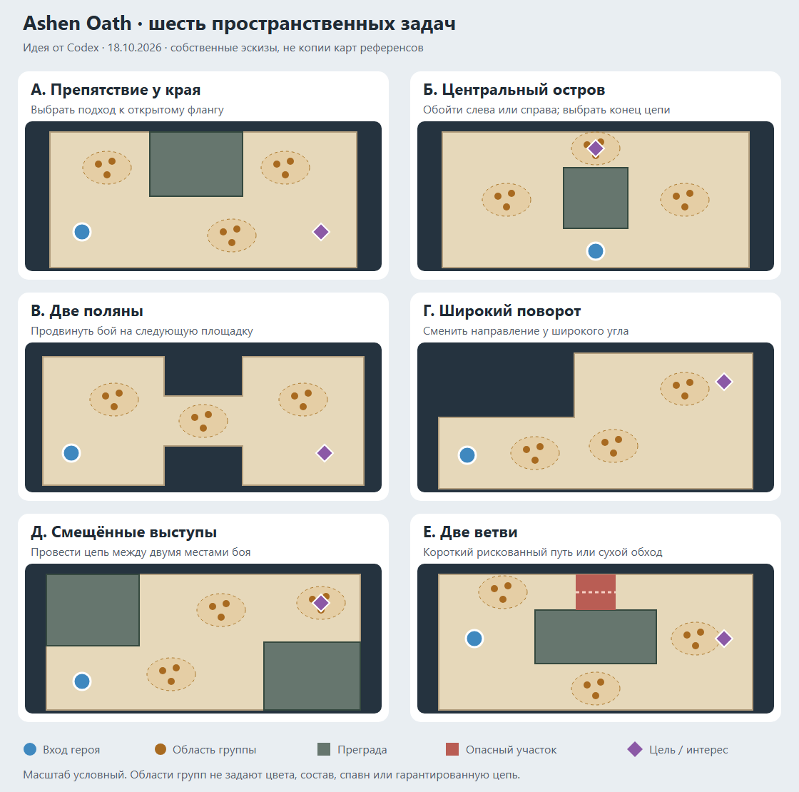

# Геометрия Cult of the Lamb, Absolum и Isaac: что взять для Ashen Oath

18.10.2026. **Исследование и идея от Codex. Не реализовано и не утверждено как новые правила.** Дополнение к [разбору первого акта](../codex-idea-act1-levels.md). Код, seed, сохранения и игровые ассеты не менялись.

Применение результатов: [подробный концепт переделки первого акта](../codex-idea-act1-redesign.md), 22 карточки арен, количества врагов, порядок ввода и кривые сложности/комплексити.

## 1. Решение, которое предлагается

Да, использовать похожие пространственные схемы имеет смысл: поляна с выступами, зал с островом, две площадки через перешеек, поворот, раскрытие после узкого участка. Для Ashen Oath предлагается собственная библиотека таких схем с нашими размерами, целями, расстановкой и пополнением. **Единица разнообразия — форма поля вместе с ситуацией боя.** Один контур не гарантирует другую игру.

Из Isaac полезнее всего взять разнообразие внутреннего устройства комнаты; из CoTL — разделение формы и совместимых вариантов встречи; из Absolum — чередование пространственных задач по мере продвижения. Это дизайнерский вывод из источников ниже, а не описание единого алгоритма этих игр.

Поправка к предыдущей идее расширения арен: свобода размера полезна, но начинать следует с изменения путей и направлений подхода. Большое поле требуется там, где в нём помещается следующая полноценная ситуация. Большинство обычных схваток может остаться компактным. Предложенные ранее 18×12, 24×14 и другие размеры — кандидаты, не обязательные цели.

## 2. Что проверено и насколько надёжно

| Игра | Доказательства | Ограничение |
|---|---|---|
| Cult of the Lamb | Локальные C# генератора, островов, дверей и волн; просмотр официальных скриншотов | Точные prefab-контуры не извлекались. Наши эскизы нельзя выдавать за найденные комнаты CoTL |
| Absolum | Четыре сцены из build 23851193: полигоны, зоны, группы встреч; официальный devlog и пресс-кит | Формат данных восстановлен без официальной схемы; активность зон, исполнение коллизий и тайминг волн в игре не проверены |
| Isaac: Repentance | Каталоги комнат Basement/Caves из STB, позиции объектов, формы и двери; документация modding API | Каталог вариантов не показывает частоты появления и фактические соединения конкретного забега |

Подробности и ссылки на конкретные записи: [CoTL](../research_notes/geometry/cotl.md), [Absolum](../research_notes/geometry/absolum.md), [Isaac](../research_notes/geometry/isaac.md). Это точечное исследование геометрии, не полный атлас всех комнат трёх игр. Игры в рамках этой проверки не запускались.

При сравнении разведены четыре слоя: **граф похода → контур пола → внутренние препятствия → расположение и развитие встречи**. Ветвистый граф не доказывает интересную геометрию боя; большой прямоугольник камеры не равен доступному полу; дерево на скриншоте не обязательно имеет коллизию.

## 3. Cult of the Lamb: заготовка пространства и варианты встречи

В проверенной копии форма комнаты выбирается через `IslandPiece`: у неё есть polygon collider и коннекторы четырёх направлений. Внутренняя встреча загружается отдельным prefab. Система старается не повторять использованные встречи до исчерпания подходящего набора. Есть волны с относительными позициями врагов и случайная раздача заранее заданных точек. Это подтверждает авторский контроль пространственной расстановки, а не равномерное заполнение любого свободного пола. Подробные основания — [в заметке](../research_notes/geometry/cotl.md).

На [официальном боевом скриншоте леса](https://shared.akamai.steamstatic.com/store_item_assets/steam/apps/1313140/ss_805babf3c8dec217798c836daea48a63b47c192b.1920x1080.jpg) видно неровное очертание открытого участка, боковые выступы растительности и широкую область боя справа. На [скриншоте босса](https://shared.akamai.steamstatic.com/store_item_assets/steam/apps/1313140/ss_90f238e89ab4c4500d3baee273419bd23f8e5f84.1920x1080.jpg) — широкое центральное пространство и выраженный периметр. Это визуальные наблюдения: по ним не установлены проходимость травы, невидимые границы и масштаб в игровых единицах. Источник изображений — [официальная галерея Steam](https://store.steampowered.com/app/1313140/Cult_of_the_Lamb/).

**Что взять:** одну узнаваемую форму и несколько специально совместимых с ней встреч. Например, поляна с выступом может принимать лучников на открытой стороне, группу ближнего боя у обхода или важную цель на дальней площадке. Это должны быть разные ситуации, а не просто перестановки одинаковой толпы.

**Что не следует из исследования:** что CoTL активно строит длинные уровни случайной стыковкой островов. В исследованной декомпиляции цикл соответствующей достройки `GeneratePath` не выполняется. Пять схем в отдельной заметке — наши предложения, а не извлечённые планы CoTL.

## 4. Isaac: знакомая комната может требовать другого маршрута

Каталог содержит обычные, узкие, удвоенные, большие и L-образные комнаты; формы отдельно перечислены в [RoomShape API](https://wofsauge.github.io/IsaacDocs/rep/enums/RoomShape.html). Даже одинаковая внешняя форма допускает разное расположение ям и камней. В проверенных обычных комнатах Caves найдены:

- центральный блок ям 3×3 со свободным обходом вокруг;
- каменный крест в центре с ямами у углов;
- узкая полоса с дополнительными ограничениями прохода;
- вытянутая комната с повторяющимися внутренними мотивами;
- широкая комната с опасными краями и открытой серединой;
- L-образная комната и большой зал с внутренними препятствиями.

Номера вариантов и фактические параметры приведены [отдельно](../research_notes/geometry/isaac.md). Они подтверждают существование схем, а не их вероятность и не качество каждого возможного боя.

**Что взять:** возможность получить новое решение в прежнем габарите. Остров делит подходы, выступ от стены меняет угол входа, две перегородки со смещёнными торцами задают диагональ. Для узнаваемости уровня этого может быть достаточно без увеличения площади.

**Адаптация к цепи:** ямы и камни нельзя переносить клетка в клетку. В Ashen Oath близкий враг за препятствием может оказаться бесполезным звеном; геометрия должна оставлять объём для нескольких соседних одноцветных целей на доступной стороне. Большое число мелких препятствий особенно рискованно: оно создаёт множество обрывов цепи вместо понятного выбора маршрута.

## 5. Absolum: геометрия меняется по ходу участка

Разработчики описывают авторские участки с несколькими вручную подготовленными вариантами, выбираемыми случайно. От полной процедурной генерации они отказались после экспериментов. Это полезный ориентир для нашего масштаба производства: небольшой набор продуманных пространств с вариантами встреч. [Официальный DEVLOG #6, 30.09.2025](https://store.steampowered.com/news/app/1904480/view/793318320683090046).

В локальных данных разобраны четыре конкретных примера:

| Участок | Наблюдение в данных | Наш возможный перевод |
|---|---|---|
| `M_LongBridge` | Расширенные подходы и более узкий центральный пролёт; отдельные группы боёв | Две поляны через короткое горло, с полноценным боевым пространством на каждой |
| `M_Funnel` | Сужение и последующее раскрытие контура; несколько групп встреч | Роща → проход между корнями → новая поляна |
| `S_Marketplace` | Повозка занимает верхнюю часть доступной полосы, оставляя нижний обход | Крупное препятствие у края, которое меняет подход, сохраняя единый объём боя |
| `S_Pond` | Контур раздваивается перед двумя именованными выходами | Внутренняя развилка с повторным соединением; выбор ветви внутри нашего боя |

Числа, восстановление типов зон и ограничения — [в заметке Absolum](../research_notes/geometry/absolum.md). Последняя адаптация намеренно меняет смысл: у нас это обход внутри одной арены, а не автоматически новый выбор узла похода.

На официальных [скриншоте 3](https://www.dotemu.com/PressKit/Games/Absolum/images/screenshots/Absolum_screenshot_3.jpg) и [скриншоте 4](https://www.dotemu.com/PressKit/Games/Absolum/images/screenshots/Absolum_screenshot_4.jpg) также видны площадки с открытым внутренним пространством и выраженными краями. Кадры не использовались как измерение коллизий. [Пресс-кит](https://www.dotemu.com/PressKit/project/Games/Absolum) представляет игру как beat-em-up с элементами roguelite; переносить пропорции его горизонтальной полосы в наш бой со всех направлений буквально не предлагается.

**Что взять:** смену «широко → собрано в одном направлении → снова широко». **Наше условие:** короткая связь между местами боя; плотность целей внутри каждого места рассчитывается отдельно от общей длины карты. Длинный путь сам по себе не является новым содержанием.

## 6. Шесть собственных схем для первого акта

[SVG для увеличения](../research_notes/geometry/ashen-patterns.svg). Это собственные топологические эскизы, не планы комнат референсов и не готовые уровни. Маркеры обозначают области групп, не обязательные точки, цвета или доступные цепи. Масштаб между схемами условный.

| Схема | Решение игрока | Где испытать | Главный риск |
|---|---|---|---|
| **А. Препятствие у края** | Войти по открытому флангу или использовать выступ для подготовки подхода | `p-archer-yard`: разрушить сходство с обычным двором | Все враги огибают один торец и превращаются в очередь |
| **Б. Центральный остров** | Выбрать сторону обхода и место, где закончится цепь | `shaman-circle`: доступ к существующей важной цели с двух сторон | Цвета разделены препятствием; вечное бегство по кольцу |
| **В. Две поляны** | Драться на своей стороне, продвинуться в проход или выйти на дальнюю | `p-gorge`: вариант практической арены | Пополнение сзади удерживает героя в первой половине; проход блокируется |
| **Г. Широкий поворот** | Сменить направление продвижения и вывести бой к повороту | `outpost`: кандидат для поздней встречи | Дальний бой не виден, герой долго идёт без доступных целей |
| **Д. Два смещённых выступа** | Провести цепь по диагонали и выбрать её конец до следующего выступа | `p-braziers`: жаровни у разных открытых участков | Единственный обязательный маршрут вместо выбора |
| **Е. Две ветви** | Выбрать короткий опасный путь или более длинный обход | `p-cliff`: переправа и сухой обход по правилам проекта | Короткая ветвь недоступна для реальных действий или всегда выгоднее |

Порядок работы: **А → Б → В**. Они проверяют три разные причины интересного движения: асимметрию края, выбор обхода, смену площадки. Остальные оставить на второй проход исследования. Не заменять автоматически первые обучающие встречи, все арены похожего имени или песочничные образцы: область опыта — выбранная версия конкретной арены.

Для первых эскизов лучше один крупный пространственный мотив на комнату. Несколько тонких стен, ям, узких дверей и тупиков одновременно затруднят понимание, что именно улучшило бой или сломало цепь. Открытые поляны тоже оставить в акте: они дают контраст и возможность развернуть сильную сборку.

## 7. Размер поля, размер боя и пополнение

Общий габарит можно менять свободнее, чем раньше, но полезно отдельно проектировать **место текущей схватки**. У него должны быть доступные близкие цели, пространство для смены позиции и понятные подходы следующих групп. Это не предложение жёстко фиксировать камеру или запрещать движение между зонами.

В текущем [пополнении](../../../src/realtime/sim/spawn.ts) большие поля используют область 16×9 около героя; увеличение плотности по площади ограничено множителем 1,1. Следовательно, поле вдвое длиннее не получает автоматически вдвое больше врагов и двух хороших встреч. Текущий выбор мест также не знает дизайнерского смысла «дальняя поляна» или «отработанный подход». Простое расширение может оставить пустоту впереди и ту же толпу вокруг героя.

**Предложение для обсуждения:** у каждой геометрической семьи задать совместимые области появления и условия их использования, вместе с палитрой и составом. Сначала проверить существующее пополнение на новых схемах; вводить дополнительные правила только при обнаруженном провале. Для длинной встречи можно отдельно испытать перенос основного давления вперёд после продвижения, сохраняя ограниченную угрозу сзади. Это новый вариант развития встречи, не уже существующая стадия и не правило для всех комнат.

Геометрия может сократить число направлений подхода, но не исправляет сама по себе непрерывное сближение всех врагов. Если любой уцелевший враг идёт в одну точку, поляна в конце концов снова становится клубком. Поэтому совместно проверяются [идеи поведения и ритма давления](../codex-idea-enemy-behavior-variety.md), но врагов не нужно массово уводить за радиус цепи.

## 8. Как понять, что стало лучше

Это критерии будущего прототипа, не результаты плейтеста:

1. **Старт:** игрок быстро понимает форму и может добраться до первой полезной цепи. Нет обязательного ожидания случайно подходящего цвета.
2. **После нескольких проходов:** форма ещё влияет на выбор стороны и конца цепи; все схемы не свелись к одинаковому бегу по внешнему периметру.
3. **После частичной зачистки и пополнения:** цели доступны в нужном месте, цвета не заперты в разных карманах, при приближении героя появление не откладывается бесконечно.
4. **После достижения цели:** отдельно проверено существующее завершение и путь выхода. Не выдавать нынешнее усиление после цели за запланированную волну до её выполнения.
5. **На нескольких seed и сборках:** сохраняются разные полезные маршруты; сильная сборка имеет право быстро закончить бой. Более долгий бой сам по себе не успех.

Сравнить с прежним вариантом время без доступного действия, длины реально выполненных цепей, число осмысленных смен фланга и причины полученного урона. Численные пороги определять по плейтесту; боты и анализаторы — вспомогательные эвристики. Отвергать карту, если она добавляет в основном ходьбу, ожидание или постоянно обрывающиеся цепи.

Если реализация будет принята отдельно: новые правила через `Params` с прежним поведением по умолчанию, воспроизводимость seed и журналов, совпадение `planChain` с исполнением, сохранение выходов `forest/`. Ни размеры референсов, ни будущие тестовые маршруты не являются основанием менять правила цепи.

## 9. Результат этой работы

Подготовлены исследование трёх игр, шесть собственных схем и рекомендации по применению в первом акте. Проверены наличие связанных документов, внутренние ссылки и отображение собственного атласа. Игровые тесты не запускались: это дизайн, runtime не менялся. Иностранные игровые ассеты не добавлялись в проект; изображения референсов просмотрены из официальных источников, локальные данные описаны сводками.
